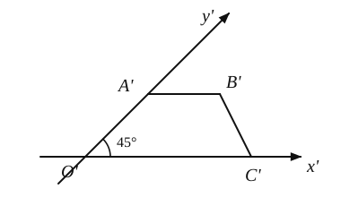
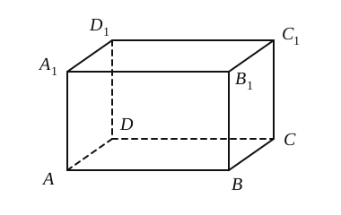
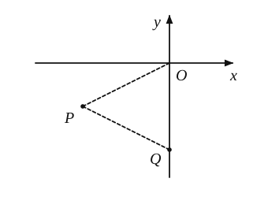
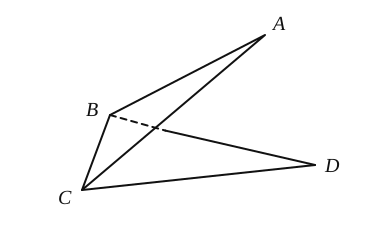
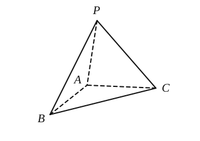
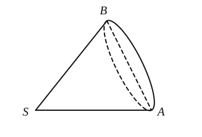
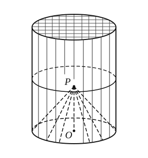
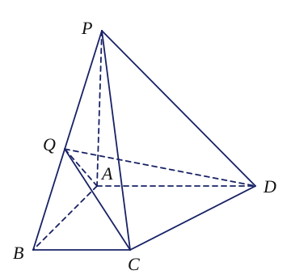
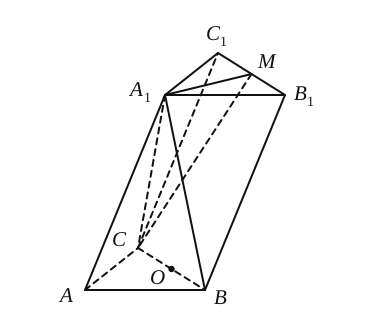

## 20261022 高二数学练习卷

### 一、填空题

1. ❌三个平面最多把空间分成 \_\_\_\_\_\_\_\_\_\_\_\_\_\_\_\_ 部分。

2. 设 $\angle A$ 和 $\angle B$ 的两边分别平行，若 $\angle A = 45^\circ$，则 $\angle B$ 的大小为 \_\_\_\_\_\_\_\_\_\_\_\_\_\_\_\_。

3. 若球的表面积为 $100\pi$，球的体积为 \_\_\_\_\_\_\_\_\_\_\_\_\_\_\_\_。

4. 已知向量 $\vec{a} = (-m, 6, 3)$ 平行于向量 $\vec{b} = (2, n, 1)$，则 $m + n =$ \_\_\_\_\_\_\_\_\_\_\_\_\_\_\_\_。

5. 一个梯形的直观图是一个如图所示的等腰梯形，且 $A'B' = 1$，$O'C' = 3$，$O'A' = 2$，则原梯形的面积为 \_\_\_\_\_\_\_\_\_\_\_\_\_\_\_\_。

    

6. 在长方体 $ABCD-A'B'C'D'$ 中，$AB = 4$，$AD = 2$，$AA' = 2$，则直线 $AB$ 到平面 $A'B'CD$ 的距离为 \_\_\_\_\_\_\_\_\_\_\_\_\_\_\_\_。

    

7. 已知二面角 $\alpha - AB - \beta$ 为 $30^\circ$，$P$ 是平面 $\alpha$ 内的一点，$P$ 到 $\beta$ 的距离为 $1$，则 $P$ 在 $\beta$ 内的射影到 $AB$ 的距离为 \_\_\_\_\_\_\_\_\_\_\_\_\_\_\_\_。

8. ❌直角坐标系 $xOy$ 内有点 $P(-2, -1)$、$Q(0, -2)$，将 $\triangle POQ$ 绕 $y$ 轴旋转一周，则所得几何体的体积为 \_\_\_\_\_\_\_\_\_\_\_\_\_\_\_\_。

    

9. 如图，边长为 $2$ 的两个等边三角形 $ABC, DBC$，若点 $A$ 到平面 $BCD$ 的距离为 $1$，则二面角 $A - BC - D$ 的大小为 \_\_\_\_\_\_\_\_\_\_\_\_\_\_\_\_。

    

10. 三棱锥 $P-ABC$ 满足：$AB \perp AC$，$AB \perp AP$，$AB = 2$，$AP + AC = 4$，则该三棱锥的体积 $V$ 的取值范围是 \_\_\_\_\_\_\_\_\_\_\_\_\_\_\_\_。

    

11. 某数学课外兴趣小组对一圆锥筒进行研究，发现将该圆锥放倒在一平面上，使圆锥在此平面内绕圆锥顶点 $S$ 滚动，当这个圆锥在平面内首次转回到原位置时，圆锥本身恰好滚动了 $4$ 周。如图，若该兴趣小组已测得圆锥的底面半径为 $2$，则该圆锥的体积为 \_\_\_\_\_\_\_\_\_\_\_\_\_\_\_\_。

    

### 二、选择题

12. ❌若 $l, m$ 是两条不同的直线，$m$ 垂直于平面 $\alpha$，则“$l \perp m$”是“$l \parallel \alpha$”的（　　）

    A. 充非必条件　　B. 必非充条件　　C. 充分必要条件　　D. 既不充分也不必要条件

13. 给出下列几个结论：① 棱锥的侧面为三角形，且所有侧面都有一个公共顶点；② 多面体至少有四个面；③ 棱台的侧棱所在直线均相交于同一点。其中，错误的个数是（　　）

    A. $0$ 个　　B. $1$ 个　　C. $2$ 个　　D. $3$ 个

### 三、解答题

14. ❌已知 $\vec{a} = (1, -2, 2)$，$\vec{b} = (3, 0, -4)$。

    （1）若 $(k\vec{a} + \vec{b}) \perp \vec{a}$，求 $k$ 的值。

    （2）求向量 $\vec{a}$ 在向量 $\vec{b}$ 上的数量投影和投影向量；

15. ❌某种“笼具”由内、外两层组成，无下底面，内层和外层分别是一个圆锥和一个圆柱，其中圆柱与圆锥的底面周长相等，圆柱有上底面，已知圆柱的底面周长为 $36\pi$，高为 $45$，圆锥的母线长为 $30$。

    （1）求这种“笼具”的体积；

    （2）求这种“笼具”的表面积；

    

16. （用空间向量）在四棱锥 $P-ABCD$ 中，已知 $PA \perp$ 平面 $ABCD$，且四边形 $ABCD$ 为直角梯形，$\angle ABC = \angle BAD = 90^\circ$，$AB = AD = AP = 2$，$BC = 1$，点 $Q$ 为线段 $BP$ 的中点。

    （1）求异面直线 $CQ$ 和 $PD$ 所成角的大小；

    （2）求点 $Q$ 到平面 $PCD$ 的距离；

    （3）求直线 $CQ$ 与平面 $PCD$ 所成角的大小；

    （4）求二面角 $P-CD-B$ 的大小。

    

17. 如图，在三棱柱 $ABC-A_1B_1C_1$ 中，$AB \perp AC$，$AB = AC$，$AA_1 = 2AB$，点 $A_1$ 在底面 $ABC$ 的射影为 $BC$ 的中点 $O$，点 $M$ 为 $B_1C_1$ 的中点。

    （1）求证：$A_1M \perp$ 平面 $A_1BC$；

    （2）❌设点 $P$ 为底面 $ABC$ 内（包括边界）的动点，且 $B_1P \parallel$ 平面 $A_1MC$，若点 $P$ 的轨迹长度为 $\sqrt{2}$，求三棱柱 $ABC-A_1B_1C_1$ 的侧面积。

    
