## 20261013 空间直线与平面练习卷

### 一、填空题

1. ❌异面直线所成角的范围是 \_\_\_\_\_\_\_\_\_\_\_\_\_\_\_\_。【看错题了】

2. 若 $a$、$b$、$c$ 为不重合的三条直线，且 $a\parallel c$，$b\parallel c$，则 $a$ 与 $b$ 的位置关系是 \_\_\_\_\_\_\_\_\_\_\_\_\_\_\_\_。

3. $\triangle O'A'B'$ 是一个平面图形的直观图（斜二测画法），若原平面图形的面积是 $4$，则 $\triangle O'A'B'$ 的面积是 \_\_\_\_\_\_\_\_\_\_\_\_\_\_\_\_。

4. 命题“若直线 $a$ 与平面 $\alpha$ 上的无数条直线垂直，则 $a\perp\alpha$”是 \_\_\_\_\_\_\_\_\_\_\_\_\_\_\_\_ 命题。

5. 若球的截面圆的面积为 $16\pi$，平面 $\alpha$ 与球心的距离为 $3$，则球的体积为 \_\_\_\_\_\_\_\_\_\_\_\_\_\_\_\_，表面积为 \_\_\_\_\_\_\_\_\_\_\_\_\_\_\_\_。

6. ❌在正方体 $ABCD-A_1B_1C_1D_1$ 中，异面直线 $AC$ 和 $BD_1$ 所成角的大小是 \_\_\_\_\_\_\_\_\_\_\_\_\_\_\_\_。【粗心】

   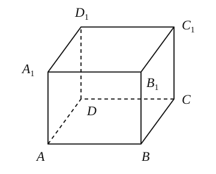

7. 将边长分别为 $3$ 和 $2$ 的矩形，绕边长为 $2$ 的一边所在的直线旋转一周得到一圆柱，则该圆柱的体积为 \_\_\_\_\_\_\_\_\_\_\_\_\_\_\_\_。

8. 已知正三棱柱 $ABC-A_1B_1C_1$ 侧棱长与底面边长相等，则 $AB_1$ 与侧面 $BCC_1B_1$ 所成角的正弦值是 \_\_\_\_\_\_\_\_\_\_\_\_\_\_\_\_。

   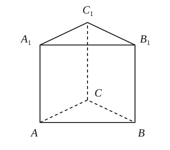

9. 已知圆锥的底面周长为 $2\pi$，其侧面展开图的圆心角为 $\dfrac{2}{3}\pi$，则该圆锥的侧面积为 \_\_\_\_\_\_\_\_\_\_\_\_\_\_\_\_。

10. 圆柱底面半径为 $3$，母线长为 $5$，一只小蜘蛛从某条母线上的一端点出发，沿着圆柱侧面爬行两周到该母线的另一个端点，则蜘蛛所走的最短路程为 \_\_\_\_\_\_\_\_\_\_\_\_\_\_\_\_。

    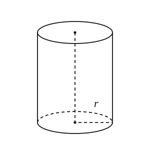

11. 如图，$P$ 为平行四边形 $ABCD$ 所在平面外一点，$E$ 为 $AD$ 的中点，$F$ 为 $PC$ 上一点，当 $PA\parallel$ 平面 $EBF$ 时，$\dfrac{PF}{FC}=$ \_\_\_\_\_\_\_\_\_\_\_\_\_\_\_\_。

    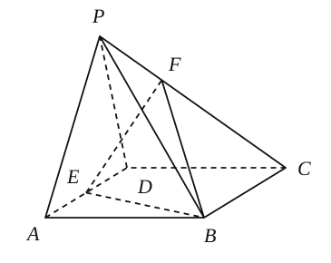

12. 如图，在直三棱柱 $ABE-DCF$ 中，侧面 $ABCD$ 的面积为 $3$，$\angle CDF$ 为直角，$\cos\angle DCF=\dfrac{1}{2}$，则三棱柱 $ABE-DCF$ 的外接球的半径取最小值时，四棱锥 $E-ABCD$ 的体积为 \_\_\_\_\_\_\_\_\_\_\_\_\_\_\_\_。

    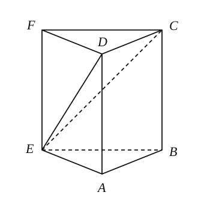

### 二、选择题

13. “直线上有两点在平面内”是“这条直线在这个平面内”的（　　）  
    A. 充非必条件　B. 必非充条件　C. 充要条件　D. 非充非必条件

14. 已知异面直线 $a$、$b$ 所成角为 $80^\circ$，$P$ 为空间一定点，则过 $P$ 点且与 $a$、$b$ 所成角都是 $45^\circ$ 的直线有且仅有（　　）条。  
    A. $2$　B. $3$　C. $4$　D. $6$

### 三、解答题

15. 已知长方体 $ABCD-A_1B_1C_1D_1$ 中，$M$、$N$ 分别是 $BB_1$ 和 $BC$ 的中点。

    （1）画出直线 $MN$ 与平面 $A_1B_1C_1D_1$ 的公共点 $K$。（保留辅助线，无需说明理由）

    （2）若 $AB=2$，$AD=1$，$AA_1=4$，求异面直线 $B_1D$ 与 $MN$ 所成角的大小。

    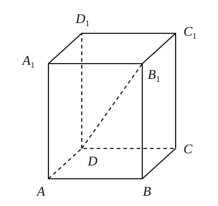

16. 如图，在直三棱柱 $A_1B_1C_1-ABC$ 中，$AB\perp AC$，$AB=AC=2$，$AA_1=4$，点 $D$ 是 $BC$ 的中点。

    （1）求证：$BA_1\parallel$ 平面 $C_1AD$；

    （2）求二面角 $A_1-BC-A$ 的大小。

    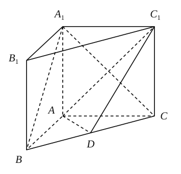

17. 如图，在圆柱中，底面直径 $AB=AD=2$，点 $E$ 在底面圆周上。

    （1）求证：平面 $BED\perp$ 平面 $ADE$；

    （2）若圆柱与三棱锥 $D-ABE$ 的体积的比等于 $3\pi$，求直线 $BD$ 与平面 $ADE$ 所成角的大小。

    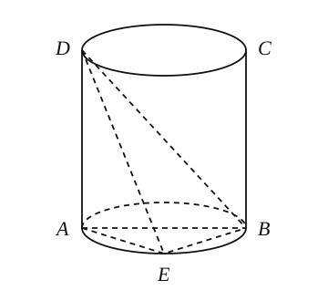

18. 某广场内设置了一些石凳供大家休息，这些石凳是由正方体截去八个一样的四面体得到的，如图所示，若被截正方体的棱长是 $60\,\mathrm{cm}$。

    （1）求石凳的体积；

    （2）为了美观工人准备将石凳的表面进行粉刷，已知每平方米造价 $50$ 元，请问粉刷一个石凳需要多少钱？（精确到 $0.1$ 元）

    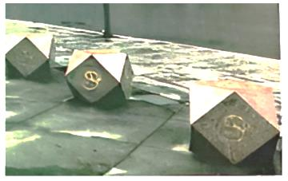

    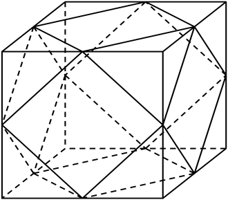

19. 如图 $1$，在矩形 $ABCD$ 中，$AB=4$，$AD=2$，将 $\triangle BCD$ 沿 $BD$ 翻折至 $\triangle BC_1D$，且 $AC_1=2\sqrt{3}$，如图 $2$ 所示。在图 $2$ 中：

    （1）求证：平面 $ABC_1\perp$ 平面 $AC_1D$；

    （2）求点 $C_1$ 到平面 $ABD$ 的距离 $d$；

    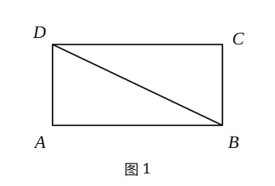

    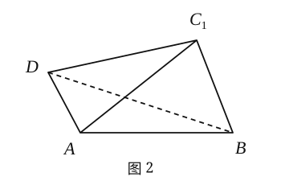
