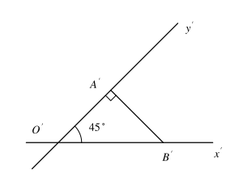
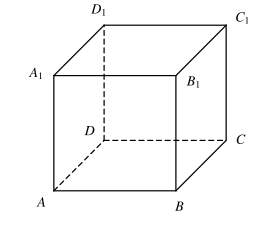
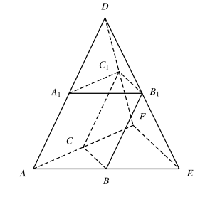
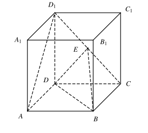
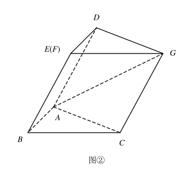

## 20261015 立体几何月考练习卷

### 一、填空题（每题 $3$ 分，满分 $36$ 分）

1. 用集合符号表示：直线 $b$ 在平面 $\alpha$ 上 \_\_\_\_\_\_\_\_\_\_\_\_\_\_\_\_。
2. 已知 $a$、$b$、$c$ 为不重合的三条直线，且 $a\parallel c$，$b\parallel c$，则 $a$ 与 $b$ 的位置关系是 \_\_\_\_\_\_\_\_\_\_\_\_\_\_\_\_。
3. 已知正方体的棱长为 $2$，则该正方体内切球的体积为 \_\_\_\_\_\_\_\_\_\_\_\_\_\_\_\_。
4. 在正方体 $ABCD-A_1B_1C_1D_1$ 中，异面直线 $AB_1$ 和 $A_1C_1$ 所成角的大小是 \_\_\_\_\_\_\_\_\_\_\_\_\_\_\_\_。 
5. ❌如图，$\mathrm{Rt}\triangle O'A'B'$ 是一个平面图形的直观图（斜二测画法），斜边 $O'B'=2$，则原平面图形的面积是 \_\_\_\_\_\_\_\_\_\_\_\_\_\_\_\_。   【三角形面积没有乘$\frac{1}{2}$】
6. 若球的半径为 $5$，平面 $\alpha$ 与球心的距离为 $3$，则平面 $\alpha$ 截球所得的圆面面积为 \_\_\_\_\_\_\_\_\_\_\_\_\_\_\_\_。
7. 在正方体 $ABCD-A_1B_1C_1D_1$ 中，二面角 $A_1-BC-A$ 的大小是 \_\_\_\_\_\_\_\_\_\_\_\_\_\_\_\_。
8. 已知斜线段的长度是斜线段在这个平面内射影的长的 $2$ 倍，则这条斜线和这个平面所成的角的大小为 \_\_\_\_\_\_\_\_\_\_\_\_\_\_\_\_。
9. 已知两条异面直线 $a$、$b$ 所成角为 $60^\circ$，$P$ 是空间一点，过 $P$ 作与 $a$、$b$ 所成的角都是 $60^\circ$ 的直线，这样的直线共有 \_\_\_\_\_\_\_\_\_\_\_\_\_\_\_\_ 条。
10. 圆台的上、下底面半径分别是 $1$ 和 $4$，高为 $5$，则其体积等于 \_\_\_\_\_\_\_\_\_\_\_\_\_\_\_\_。
11. 如图，在三棱锥 $D-AEF$ 中，$A_1$、$B_1$、$C_1$ 分别是 $DA$、$DE$、$DF$ 的中点，$B$、$C$ 分别是 $AE$、$AF$ 的中点，设三棱柱 $ABC-A_1B_1C_1$ 的体积为 $V_1$，三棱锥 $D-AEF$ 的体积为 $V_2$，则 $V_1:V_2=\underline{\qquad\qquad}$。 
12. ❌如图，在棱长为 $2$ 的正方体 $ABCD-A_1B_1C_1D_1$ 中，点 $P$ 在平面 $ABCD$ 内，若直线 $D_1P$ 与平面 $A_1BC_1$ 无公共点，则线段 $D_1P$ 长度的最小值是 \_\_\_\_\_\_\_\_\_\_\_\_\_\_\_\_。   

### 二、选择题（每小题 $4$ 分，满分 $16$ 分）

13. 已知 $a$、$b$ 是两条直线，则“$a$、$b$ 没有公共点”是“$a$、$b$ 是异面直线”的（　　）。  
    A. 充分不必要条件　　              B. 必要不充分条件                C. 充要条件　　D. 既不充分又不必要条件
    
14. ❌在空间中，下列命题为真命题的是（　　）。  【基础概念】
    A. 若两条直线垂直于第三条直线，则这两条直线互相平行；  
    B. 若两个平面分别平行于两条互相垂直的直线，则这两个平面互相垂直；  
    C. 若两个平面垂直，则过一个平面内一点垂直于交线的直线与另外一个平面垂直；  
    D. 若一条直线平行于一个平面，另一条直线与这个平面垂直，则这两条直线互相垂直。

15. 设矩形边长分别为 $a$、$b$（$a>b$），分别以 $a$、$b$ 两边为轴旋转一周所得旋转体的体积记为 $V_a$ 和 $V_b$，则 $V_a$ 与 $V_b$ 的大小关系是（　　）。  
    A. $V_a>V_b$　　                                                     B. $V_a=V_b$  
    C. $V_a<V_b$　　                                                     D. $V_a$、$V_b$ 的大小不确定

16. $M$、$N$ 分别为菱形 $ABCD$ 的边 $BC$、$CD$ 的中点，将菱形沿对角线 $AC$ 折起，使点 $D$ 不在平面 $ABC$ 内，则在翻折过程中，对于下列两个命题：①直线 $MN$ 恒与平面 $ABD$ 平行；②异面直线 $AC$ 与 $MN$ 恒垂直。以下判断正确的是（　　）。  
    A. ①为真命题，②为真命题　　                         B. ①为真命题，②为假命题  
    C. ①为假命题，②为真命题　　                         D. ①为假命题，②为假命题
    

### 三、解答题（$8+10+10+10+10=48$ 分）

17. 正三棱锥 $A-BCD$ 中，底面边长为 $6$，侧棱长 $8$。
    （1）求侧棱 $AD$ 与底面 $BCD$ 所成的角的余弦值。
    （2）❌求正三棱锥 $A-BCD$ 的体积。【计算错】
    

18. ❌一个几何体由圆锥和圆柱组成，其尺寸如图所示。（$a=2$）
    （1）求此几何体的==侧面积==；【看错题，求成表面积】
    （2）$P$ 为所在母线中点，$Q$ 为母线与底面圆交点，求在几何体表面上，从 $P$ 点到 $Q$ 点的最短路径长。【比较难，陷阱题】
    

19. 已知在正四棱柱 $ABCD-A_1B_1C_1D_1$ 中，$AD=4$，$AA_1=3$，点 $E$ 是 $CD_1$ 的中点。
    （1）求证：$AD_1\parallel$ 平面 $EBD$；❌（2）求异面直线 $AD_1$ 与 $DE$ 所成角的大小。【细节错，条件没写对】
    

20. 如图，在正三棱柱 $ABC-A_1B_1C_1$ 中，已知 $AB=AA_1=2$，$D$、$E$ 分别是 $AB$、$A_1B_1$ 的中点。
    （1）求证：平面 $CDB_1\perp$ 平面 $ABB_1A_1$；
    （2）❌求证：平面 $AC_1E\parallel$ 平面 $CDB_1$。【证明不对】
    

21. 图①是由矩形 $ADEB$、$\mathrm{Rt}\triangle ABC$ 和菱形 $BFGC$ 组成的一个平面图形，其中 $AB=1$，$BE=BF=2$，$\angle CBF=60^\circ$。将其沿 $AB$、$BC$ 折起使得 $BE$ 与 $BF$ 重合，连接 $DG$，如图②。
    （1）证明：$DG\parallel$ 平面 $ABC$；
    （2）求直线 $AG$ 与平面 $ABC$ 所成角的正切值。
        
