## 20261022 高二数学期中复习1

### 一、填空题

1. ❌空间三条直线两两相交，最多可以确定 \_\_\_\_\_\_\_\_\_\_\_\_\_\_\_\_ 个平面。

2. 若一个圆锥的轴截面（如图所示）是边长为 $3,3,2$ 的三角形，则该圆锥的侧面积是 \_\_\_\_\_\_\_\_\_\_\_\_\_\_\_\_。

    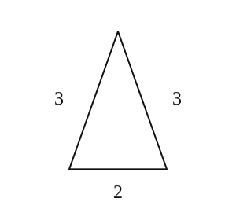

3. 若正方体的棱长为 $1$，则该正方体的外接球的体积为 \_\_\_\_\_\_\_\_\_\_\_\_\_\_\_\_。

4. “一个棱锥的各个侧面与底面所成的角相等”是“棱锥为正棱锥”的 \_\_\_\_\_\_\_\_\_\_\_\_\_\_\_\_ 条件。

5. 两异面直线 $a$、$b$ 所成角为 $50^\circ$，过空间任意一点 $P$ 作直线与 $a$、$b$ 所成的角为等角，且该角为 $50^\circ$，则所作直线的数目为 \_\_\_\_\_\_\_\_\_\_\_\_\_\_\_\_。

6. 已知水平放置的 $\triangle ABC$ 的直观图 $\triangle A'B'C'$（斜二测画法）是边长为 $\sqrt{2}a$ 的正三角形，则原 $\triangle ABC$ 的面积为 \_\_\_\_\_\_\_\_\_\_\_\_\_\_\_\_。

7. 一个三棱锥的三个侧面两两互相垂直，它们的面积分别为 $2\mathrm{cm}^2$、$4\mathrm{cm}^2$、$6\mathrm{cm}^2$，那么它的体积是 \_\_\_\_\_\_\_\_\_\_\_\_\_\_\_\_。

8. 正四棱柱 $ABCD-A_1B_1C_1D_1$ 的底面边长为 $2$，若 $AC_1$ 与底面 $ABCD$ 所成角为 $60^\circ$，则 $A_1C_1$ 和底面 $ABCD$ 的距离是 \_\_\_\_\_\_\_\_\_\_\_\_\_\_\_\_。

9. 在四面体 $ABCD$ 中，$AB=8$，$CD=6$，$M$、$N$ 分别是 $BC$、$AD$ 的中点，且 $MN=5$，则 $AB$ 与 $CD$ 所成角的大小是 \_\_\_\_\_\_\_\_\_\_\_\_\_\_\_\_。

    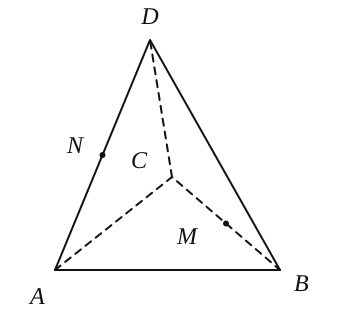

10. 在《九章算术》中，将底面为直角三角形，侧棱垂直于底面的三棱柱称之为堑堵，如图，在堑堵 $ABC-A_1B_1C_1$ 中，$AB=BC=1$，$A_1A=2$，堑堵的顶点 $C_1$ 到平面 $A_1AB$ 的距离为 \_\_\_\_\_\_\_\_\_\_\_\_\_\_\_\_。

    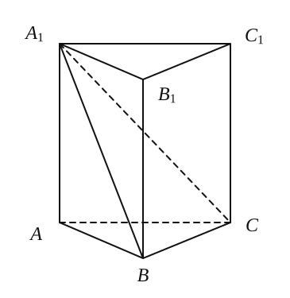

11. 在棱长为 $2$ 的正方体 $ABCD-A_1B_1C_1D_1$ 中，$E$、$F$ 分别为棱 $AB$、$BC$ 上的动点，且 $AE=BF$，则三棱锥 $B_1-BEF$ 的体积的最大值为 \_\_\_\_\_\_\_\_\_\_\_\_\_\_\_\_。

    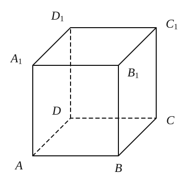

12. ❌有两个相同的直三棱柱，高为 $\dfrac{2}{a}$，底面三角形的三边长分别为 $3a,4a,5a$（$a>0$），用它们拼成一个三棱柱或四棱柱，在所有可能的情况中，全面积最小的是一个四棱柱，则 $a$ 的取值范围是 \_\_\_\_\_\_\_\_\_\_\_\_\_\_\_\_。

    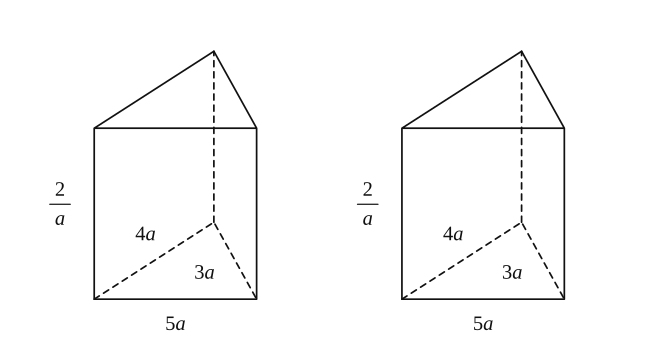

### 二、选择题

13. 给定空间中的直线 $l$ 及平面 $\alpha$，条件“直线 $l$ 与平面 $\alpha$ 内无数条直线都垂直”是“直线 $l$ 与平面 $\alpha$ 垂直”的（　　）条件。

    A. 充分非必要　　B. 必要非充分　　C. 充要条件　　                  D. 既非充分也非必要

14. ❌过正方体中心的平面截正方体所得的截面中，不可能的图形是（　　）。

    A. 三角形　　       B. 长方形　　        C. 对角线不相等的菱形　　D. 六边形

15. $l_1,l_2,l_3$ 是空间三条不同的直线，下列命题正确是（　　）。

    A. $l_1\perp l_2,\ l_2\perp l_3\Rightarrow l_1\parallel l_3$  
    B. $l_1\perp l_2,\ l_2\perp l_3\Rightarrow l_1\perp l_3$  
    C. $l_1\parallel l_2,\ l_2\parallel l_3\Rightarrow l_1\parallel l_3$  
    D. $l_1\parallel l_2\parallel l_3\Rightarrow l_1,l_2,l_3$ 共面

16. 在梯形 $ABCD$ 中，$\angle ABC=\dfrac{\pi}{2}$，$AD\parallel BC$，$BC=2AD=2AB=2$，将梯形 $ABCD$ 绕 $AD$ 所在的直线旋转一周而形成的曲面所围成的几何体的体积为（　　）。

    A. $\dfrac{2\pi}{3}$　　B. $\dfrac{4\pi}{3}$　　C. $\dfrac{5\pi}{3}$　　D. $2\pi$

    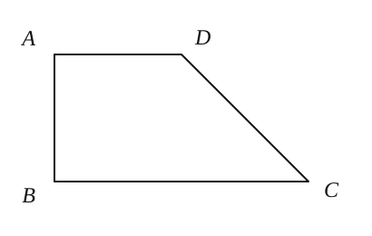

### 三、解答题

17. 如图，在 $\mathrm{Rt}\triangle AOB$ 中，$\angle OAB=\dfrac{\pi}{6}$，斜边 $AB=4$，$D$ 是 $AB$ 的中点，现将 $\mathrm{Rt}\triangle AOB$ 以直角边 $AO$ 为轴旋转一周得到一个圆锥，点 $C$ 为圆锥底面圆周上的一点，且 $\angle BOC=90^\circ$。求：

    （1）圆锥的侧面积；

    （2）❌异面直线 $CD$ 与 $AO$ 所成的角的大小。（用反三角函数表示）

    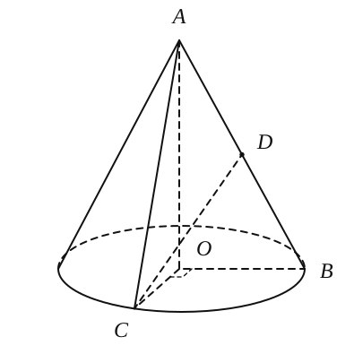

18. 在正四棱锥 $P-ABCD$ 中，$PA=AB=a$，$E$ 是棱 $PC$ 的中点。

    （1）求证：$PC\perp BD$；

    （2）求直线 $BE$ 与 $PA$ 所成角的余弦值。

    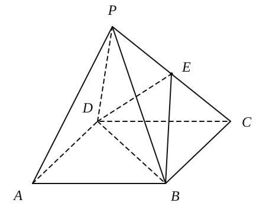

19. 已知正方形 $ABED$ 的边长为 $\sqrt{2}$，$O$ 为两条对角线的交点，如图所示，将 $\mathrm{Rt}\triangle BED$ 沿 $BD$ 所在的直线折起，使得点 $E$ 移至点 $C$，满足 $AB=AC$。

    （1）求四面体 $ABCD$ 的体积 $V$；

    （2）求直线 $BC$ 与平面 $ACD$ 所成的角的大小。

    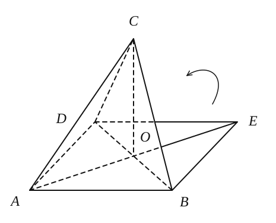

20. 如图，在直三棱柱 $ABC-A_1B_1C_1$ 中，已知 $AA_1=BC=AB=2$，$AB\perp BC$。

    （1）求点 $A$ 与平面 $A_1B_1C$ 的距离；

    （2）求平面 $A_1B_1C$ 与平面 $ABC$ 所成的锐二面角的大小。

    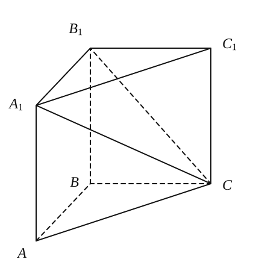

21. 如图，该几何体由半圆柱体与直三棱柱构成，半圆柱体底面直径 $BC=4$，$AB=AC$，$\angle BAC=90^\circ$，$D$ 为半圆弧的中点，若异面直线 $BD$ 和 $AB_1$ 所成角的大小为 $\arccos\dfrac{2}{3}$。求：

    （1）该几何体的体积；

    （2）直线 $AD$ 与平面 $ACC_1A_1$ 所成角的大小。

    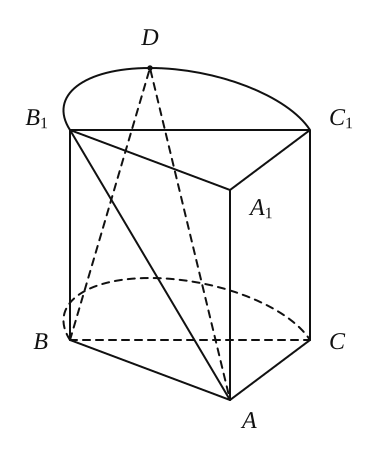
