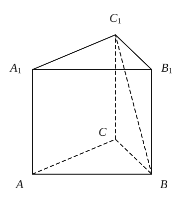
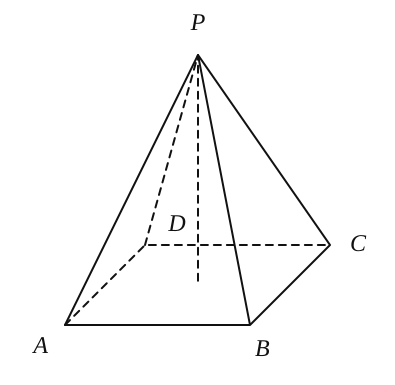
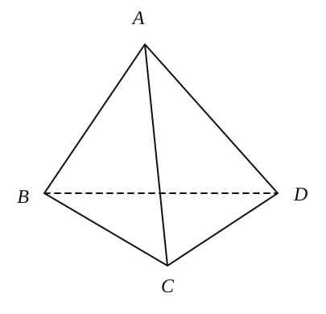
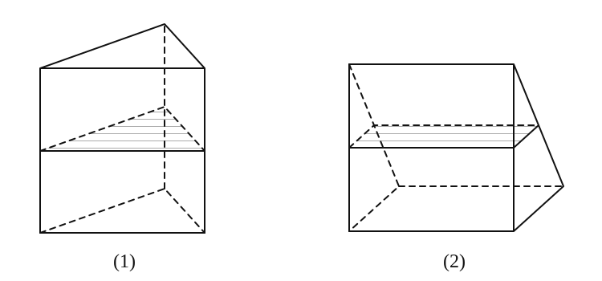
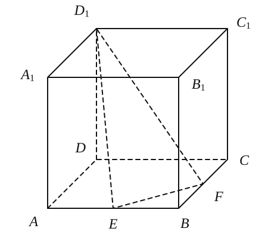
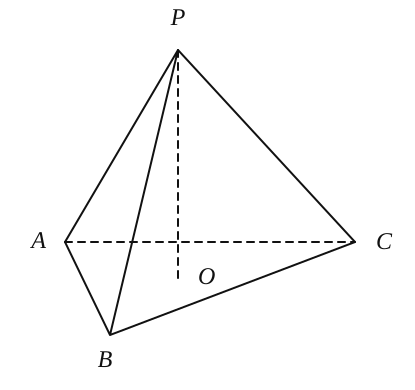
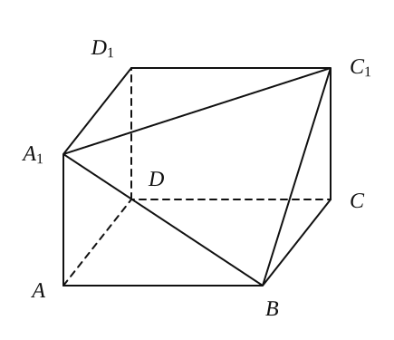
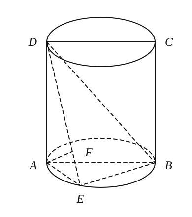
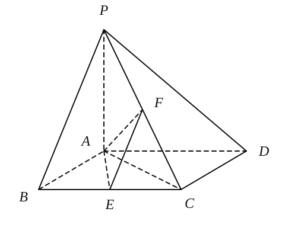

## 20261026 高二数学期中复习 2

### 一、填空题

1. 边长为 $2\,\mathrm{cm}$ 的正方形在“斜二测”作图中的直观图的面积是 \_\_\_\_\_\_\_\_\_\_\_\_\_\_\_\_。

2. 已知球的体积为 $36\pi$，则该球的表面积为 \_\_\_\_\_\_\_\_\_\_\_\_\_\_\_\_。

3. 命题 $P$：“在平面 $\alpha$ 内有无数条直线与平面 $\beta$ 平行”，命题 $Q$：“平面 $\alpha$ 与平面 $\beta$ 平行”，则 $P$ 是 $Q$ 的 \_\_\_\_\_\_\_\_\_\_\_\_\_\_\_\_ 条件。

4. 若某圆锥的侧面展开图是一个半径为 $1$ 的半圆，求圆锥的表面积 \_\_\_\_\_\_\_\_\_\_\_\_\_\_\_\_。

5. 如图，在正三棱柱 $ABC-A_1B_1C_1$ 中，侧棱长为 $\sqrt{2}$，底面三角形的边长为 $1$，则 $BC_1$ 与侧面 $ACC_1A_1$ 所成的角是 \_\_\_\_\_\_\_\_\_\_\_\_\_\_\_\_。   

6. 正四棱锥每两条相邻侧棱所成的角都是 $60^\circ$，侧棱长为 $2$，则它的体积是 \_\_\_\_\_\_\_\_\_\_\_\_\_\_\_\_。    

7. 正六棱柱 $ABCDEF-A_1B_1C_1D_1E_1F_1$ 的侧面都是边长为 $a$ 的正方形，则对角面 $A_1ACC_1$ 的面积是 \_\_\_\_\_\_\_\_\_\_\_\_\_\_\_\_。

8. 把边长为 $a$ 的正三角形 $ABC$ 沿高线 $AD$ 折成 $60^\circ$ 的二面角，点 $A$ 到 $BC$ 的距离是 \_\_\_\_\_\_\_\_\_\_\_\_\_\_\_\_。

9. 设正四面体 $ABCD$ 的棱长为 $a$，$P$ 是棱 $AB$ 上的任意一点，且 $P$ 到面 $ACD$、$BCD$ 的距离分别为 $d_1,d_2$，则 $d_1+d_2=$ \_\_\_\_\_\_\_\_\_\_\_\_\_\_\_\_。    

10. 把一个圆锥截成圆台，已知圆台的上、下底面半径的比为 $1:4$，母线（原圆锥母线在圆台中的部分）长为 $10\,\mathrm{cm}$，求原圆锥的母线长 $=$ \_\_\_\_\_\_\_\_\_\_\_\_\_\_\_\_。

11. 在一个水平放置的底面半径为 $\sqrt{3}\,\mathrm{cm}$ 的圆柱形量杯中装有适量的水，现放入一个半径为 $R\,\mathrm{cm}$ 的实心铁球，球完全浸没于水中且无水溢出，若水面高度恰好上升 $R\,\mathrm{cm}$，则 $R=$ \_\_\_\_\_\_\_\_\_\_\_\_\_\_\_\_ $\mathrm{cm}$。

12. 如图（1）是一个正三棱柱容器，高为 $2a$，内装水若干，将容器放倒，把一个侧面作为底面如图（2）所示，这时水面恰好为中截面，则图（1）所示容器中水面的高度是 \_\_\_\_\_\_\_\_\_\_\_\_\_\_\_\_。    

### 二、选择题

13. 两个不同的平面 $\alpha$、$\beta$，$m$ 为平面 $\alpha$ 内的一条直线，则“$\alpha\perp\beta$”是“$m\perp\beta$”的（　　）。
    A. 充非必条件　　                  B. 必非充条件　　 C. 充要条件　　    D. 既不充分也不必要条件

14. 圆锥轴截面顶角为 $\alpha$，它的侧面展开图扇形的圆心角为（　　）。
    A. $\pi\sin\alpha$　                  　           B. $2\pi\sin\alpha$　　       C. $2\pi\sin\dfrac{\alpha}{2}$　　        D. $\pi\sin\dfrac{\alpha}{2}$

15. 已知空间两条直线 $m$、$n$，两个平面 $\alpha$、$\beta$，给出下面四个命题：
    ① $m\parallel n,\ m\perp\alpha\Rightarrow n\perp\alpha$；                   ② $\alpha\parallel\beta,\ m\subset\alpha,\ n\subset\beta\Rightarrow m\parallel n$；
    ③ $m\parallel n,\ m\parallel\alpha\Rightarrow n\parallel\alpha$；                      ④ $\alpha\parallel\beta,\ m\parallel n,\ m\perp\alpha\Rightarrow n\perp\beta$。
    其中正确的序号是（　　）。
    
    A. ①④　　B. ②③　　C. ①②④　　D. ①③④

16. 如图，正方体 $ABCD-A_1B_1C_1D_1$ 中，$E$、$F$ 分别是 $AB$、$BC$ 的中点，过点 $D_1$、$E$、$F$ 的截面将正方体分割成两个部分，记这两个部分的体积分别为 $V_1,V_2$（$V_1<V_2$），则 $V_1:V_2=$（　　）。
    A. $\dfrac{2}{3}$　　                                B. $\dfrac{3}{5}$　　                     C. $\dfrac{25}{47}$　　                      D. $\dfrac{27}{46}$
    

### 三、解答题

17. 已知等边圆柱（轴截面为正方形的圆柱）全面积为 $6\pi$，求内接正四棱柱的全面积。

18. 已知 $P$ 在平面 $ABC$ 外，满足 $PA\perp BC$，$PB\perp AC$，$PO\perp$ 平面 $ABC$，垂足为 $O$，求证：$O$ 为底面 $\triangle ABC$ 的垂心。
    

19. 在长方体 $ABCD-A_1B_1C_1D_1$ 中，$AB=BC=6$，用过 $A_1$、$B$、$C_1$ 三点的平面截去长方体的一个角后，留下如图的几何体，且这几何体的体积为 $120$。
    （1）求棱 $AA_1$ 的长；
    （2）求点 $D_1$ 到平面 $A_1BC_1$ 的距离。
    

20. 如图，圆柱的轴截面 $ABCD$ 是正方形，点 $E$ 在底面的圆周上，$AF\perp DE$，$F$ 是垂足。
    （1）求证：$AF\perp DB$；
    （2）如果圆柱与三棱锥 $D-ABE$ 的体积的比等于 $3\pi$，求直线 $DE$ 与平面 $ABCD$ 所成的角的大小。
    

21. 如图，已知四棱锥 $P-ABCD$ 的底面 $ABCD$ 为正方形，$PA\perp$ 平面 $ABCD$，$E$、$F$ 分别是 $BC$、$PC$ 的中点，$AB=2$，$AP=2$。
    （1）求直线 $PD$ 与平面 $AEF$ 所成的角的大小；
    （2）求二面角 $F-AE-D$ 的大小。
    
