## 20261026 高二数学期中复习 3

### 一、填空题

1. 已知 $a$、$b$、$c$ 为不重合的三条直线，且 $a\parallel c$，$b\parallel c$，则 $a$ 与 $b$ 的位置关系是 \_\_\_\_\_\_\_\_\_\_\_\_\_\_\_\_。

2. 一个圆锥的轴截面是边长为 $2$ 的正三角形，则此圆锥的体积为 \_\_\_\_\_\_\_\_\_\_\_\_\_\_\_\_。

3. 一平面截一球得到直径是 $6\,\mathrm{cm}$ 的圆面，球心到这个平面的距离是 $4\,\mathrm{cm}$，则该球的表面积是 \_\_\_\_\_\_\_\_\_\_\_\_\_\_\_\_ $\mathrm{cm}^2$。

4. 若圆柱的侧面展开图是一个正方形，则它的母线长和底面半径的比值是 \_\_\_\_\_\_\_\_\_\_\_\_\_\_\_\_。

5. ❌已知 $ABCD-A_1B_1C_1D_1$ 是底面边长为 $1$ 的正四棱柱，高 $AA_1=2$，则四面体 $AB_1D_1C$ 的体积为 \_\_\_\_\_\_\_\_\_\_\_\_\_\_\_\_。

   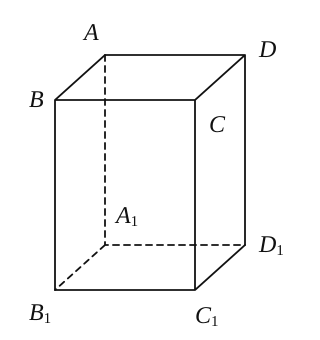

6. 若正四棱锥的底面边长为 $2\sqrt{3}\,\mathrm{cm}$，体积为 $4\,\mathrm{cm}^3$，则它的侧棱与底面所成的角的大小是 \_\_\_\_\_\_\_\_\_\_\_\_\_\_\_\_。

7. 如图，已知正三棱柱 $ABC-A_1B_1C_1$ 的体积为 $9\sqrt{3}$，底面边长为 $3$，则异面直线 $BC_1$ 与 $AC$ 所成的角为 \_\_\_\_\_\_\_\_\_\_\_\_\_\_\_\_。

   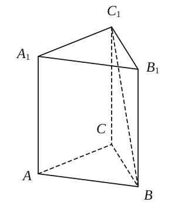

8. 在正方体 $AC_1$ 中，$E$、$F$ 分别是 $AB$、$BC$ 的中点，那么二面角 $B_1-EF-B$ 的大小为 \_\_\_\_\_\_\_\_\_\_\_\_\_\_\_\_。

   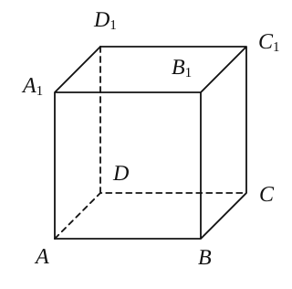

9. 在地面上有 $A$、$B$、$C$ 三个对空观测站，每两站之间的距离为 $6\,\mathrm{km}$，若由 $A$、$B$、$C$ 三个观测站同时测得空中一架飞机 $P$ 的仰角均为 $45^\circ$，则飞机离地面的高度为 \_\_\_\_\_\_\_\_\_\_\_\_\_\_\_\_。

   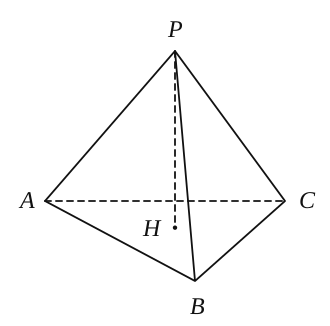

10. 已知 $A$、$B$ 是球 $O$ 的球面上两点，$\angle AOB=90^\circ$，$C$ 为该球面上的动点，若三棱锥 $O-ABC$ 体积的最大值为 $\dfrac{32}{3}$，则球 $O$ 的表面积为 \_\_\_\_\_\_\_\_\_\_\_\_\_\_\_\_。

    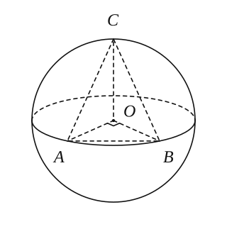

11. 正四棱台上、下底面的边长分别为 $3$、$5$，侧棱长为 $4$，则此棱台的侧面积为 \_\_\_\_\_\_\_\_\_\_\_\_\_\_\_\_。

    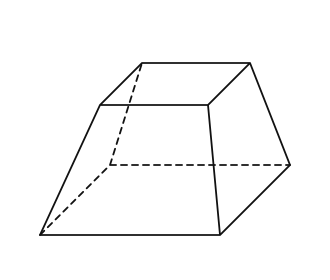

12. 由“若直角三角形两直角边的长分别为 $a,b$，将其补成一个矩形，则根据矩形的对角线长可求得该直角三角形外接圆的半径为 $r=\dfrac{\sqrt{a^2+b^2}}{2}$”。对于“若三棱锥三条侧棱两两垂直，侧棱长分别为 $a,b,c$”，类比上述处理方法，可得该三棱锥的外接球半径为 $R=$ \_\_\_\_\_\_\_\_\_\_\_\_\_\_\_\_。

### 二、选择题

13. 当我们停放自行车时，只要将自行车旁的撑脚放下，自行车就稳了，这用到了（　　）。

    A. 三点确定一平面　　B. 不共线三点确定一平面  
    C. 两条相交直线确定一平面　　D. 两条平行直线确定一平面

14. 下列四个命题中真命题是（　　）。

    A. 同垂直于一直线的两条直线互相平行  
    B. 底面各边相等，侧面都是矩形的四棱柱是正四棱柱  
    C. 过空间任一点与两条异面直线都垂直的直线有且只有一条  
    D. 过球面上任意两点的大圆有且只有一个

15. 如右图，正方体 $A_1B_1C_1D_1-ABCD$ 中，$E$、$F$ 分别为棱 $A_1A$、$BC$ 上的点，在平面 $ADD_1A_1$ 内且与平面 $DEF$ 平行的直线（　　）。

    A. 有一条　　B. 有二条　　C. 有无数条　　D. 不存在

    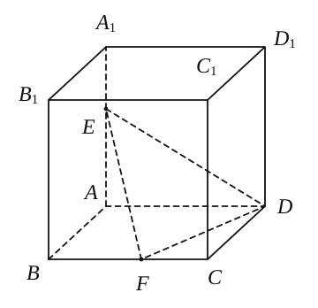

16. 魏晋时期数学家刘徽在著作《九章算术注》中，称一个正方体内两个互相垂直的内切圆柱所围成的几何体为“牟合方盖”。刘徽通过计算得知正方体的内切球的体积与“牟合方盖”的体积之比应为 $\pi:4$。若正方体的棱长为 $2$，则“牟合方盖”的体积为（　　）。

    A. $16$　　B. $16\sqrt{3}$　　C. $\dfrac{16}{3}$　　D. $\dfrac{128}{3}$

### 三、解答题

17. 在三棱锥 $P-ABC$ 中，已知 $PA=PB=PC=1$，$AB=\sqrt{2}$，$BC=1$，$AC=\sqrt{3}$。求该三棱锥底面 $ABC$ 上的高与三棱锥的体积。

18. 如图，在四棱锥 $P-ABCD$ 中，底面 $ABCD$ 是边长为 $2$ 的正方形，$PA\perp$ 平面 $ABCD$，$PC$ 与平面 $ABCD$ 所成角的大小为 $\dfrac{\pi}{3}$，$M$ 为 $PA$ 的中点。

    （1）求四棱锥 $P-ABCD$ 的体积；

    （2）求异面直线 $BM$ 与 $PC$ 所成角的大小（结果用反三角函数值表示）。

    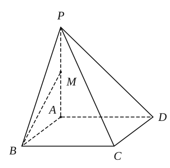

19. 如图，已知 $\triangle ABC$ 是正三角形，$EA$、$CD$ 都垂直于平面 $ABC$，且 $EA=AB=2a$，$DC=a$，$F$ 是 $BE$ 的中点。

    （1）求证：$FD\parallel$ 平面 $ABC$；

    （2）求证：$AF\perp$ 平面 $EDB$。

    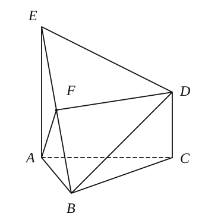

20. ❌如图，在多面体 $ABC-A_1B_1C_1$ 中，$AA_1$、$BB_1$、$CC_1$ 均垂直于平面 $ABC$，$AA_1=4$，$CC_1=3$，$BB_1=AB=AC=BC=2$。求点 $A$ 到平面 $A_1B_1C_1$ 的距离。

    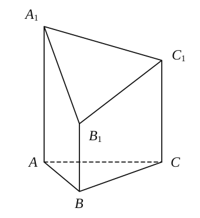

21. 将一块边长为 $10\,\mathrm{cm}$ 的正方形铁片裁下如图所示的阴影部分，用余下的四个全等的等腰三角形加工成一个无盖的正四棱锥形容器罩。

    （1）试把容器罩的表面积 $S$ 表示为 $x$ 的函数；

    （2）试把容器罩的体积 $V$ 表示为 $x$ 的函数。

    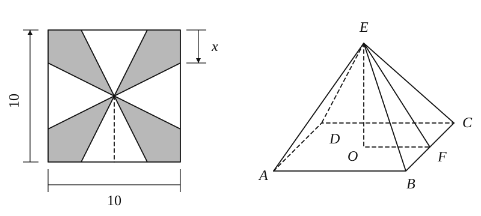
