## 20261028 高二数学期中复习 4

### 一、填空题

1. 空间两个角的两边分别平行，则这两个角的大小关系是 \_\_\_\_\_\_\_\_\_\_\_\_\_\_\_\_。

2. 圆锥的底面半径为 $3$，其侧面展开图是一个圆心角为 $\dfrac{2}{3}\pi$ 的扇形，则此圆锥的母线长为 \_\_\_\_\_\_\_\_\_\_\_\_\_\_\_\_。

3. 已知圆台的底面圆半径分别为 $1$ 和 $2$，高为 $3$，则其体积为 \_\_\_\_\_\_\_\_\_\_\_\_\_\_\_\_。

4. 如图，在正方体 $ABCD-A_1B_1C_1D_1$ 中，二面角 $A_1-BD-A$ 大小为 \_\_\_\_\_\_\__\_\_\_\_\_\_\_（用反三角函数值表示）。 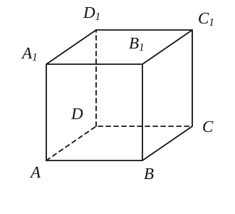

5. 正四棱锥的侧面积为 $12\sqrt{34}$，底面边长为 $6$，则棱锥的高为 \_\_\_\_\_\_\_\_\_\_\_\_\_\_\_\_。 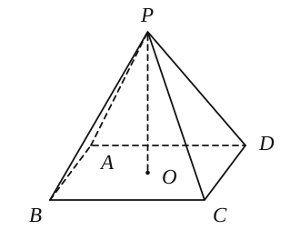

6. 设三棱锥 $P-ABC$ 的三条侧棱 $PA$、$PB$、$PC$ 两两垂直，已知它的体积是 $6\,\mathrm{cm}^3$，侧面 $PAB$、$PBC$ 的面积分别是 $9\,\mathrm{cm}^2$、$3\,\mathrm{cm}^2$，那么侧面 $PAC$ 的面积是 \_\_\_\_\_\_\_\_\_\_\_\_\_\_\_\_。

7. ❌如图所示，半径 $R=2$ 的球 $O$ 中有一内接圆柱，当圆柱的侧面积最大时，圆柱的侧面积等于 \_\_\_\_\_\_\_\_\_\_\_\_\_\_\_\_。   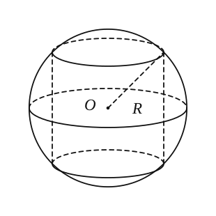~~球的表面积与圆柱的侧面积之差~~

8. ❌错若一正三棱锥的底面边长是 $a$，体积为 $\dfrac{\sqrt{3}a^3}{12}$，则此三棱锥的侧棱与底面所成角的大小为 \_\_\_\_\_\_\_\_\_\_\_\_\_\_\_\_。

9. 如图所示，在边长为 $4$ 的正方形纸片 $ABCD$ 中，$AC$ 与 $BD$ 相交于 $O$，剪去 $\triangle AOB$，将剩余部分沿 $OC$、$OD$ 折叠，使 $OA$、$OB$ 重合，则以 $A(B)$、$C$、$D$、$O$ 为顶点的四面体的体积为 \_\_\_\_\_\_\_\_\_\_\_\_\_\_\_\_。 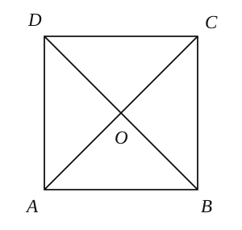

10. 以正方体 $ABCD-A_1B_1C_1D_1$ 的顶点为顶点，且四个面均为直角三角形的四面体是 \_\_\_\_\_\_\_\_\_\_\_\_\_\_\_\_。    

    （要求：只写出其中的一个，并在图中画出相应的四面体）

11. 已知用通过圆锥的轴的平面去截一个圆锥，得到的截面是面积为 $9\sqrt{3}\,\mathrm{cm}^2$ 的正三角形，求此圆锥内接球的半径为 \_\_\_\_\_\_\_\_\_\_\_\_\_\_\_\_。

12. 如图所示，$\triangle A'B'C'$ 表示水平放置的 $\triangle ABC$ 在斜二测画法下的直观图，$A'B'$ 在 $x'$ 轴上，$B'C'$ 与 $x'$ 轴垂直，且 $B'C'=3$，则 $\triangle ABC$ 的边 $AB$ 上的高为 \_\_\_\_\_\_\_\_\_\_\_\_\_\_\_\_。    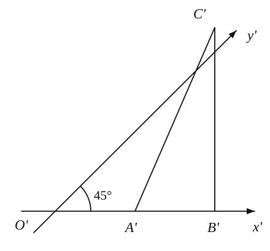

### 二、选择题

13. 下列命题中，不正确的是（　　）。
    A. 棱长都相等的长方体是正方体；                            B. 有两个相邻侧面为矩形的棱柱为直棱柱；  
    C. 有两个侧面与底面垂直的棱柱为直棱柱；             D. 底面为平行四边形的四棱柱叫平行六面体。
    
14. 已知直线 $l$、$m$、$n$ 及平面 $\alpha$，下列命题中的假命题是（　　）。
    A. 若 $l\parallel m$，$m\parallel n$，则 $l\parallel n$。                                    B. 若 $l\perp\alpha$，$n\parallel\alpha$，则 $l\perp n$。  
    C. 若 $l\perp m$，$m\parallel n$，则 $l\perp n$。                                  D. 若 $l\parallel\alpha$，$n\parallel\alpha$，则 $l\parallel n$。
    
15. 若一个三棱锥的顶点在底面的射影为三角形的内心，则此三棱锥的（　　）。
    A. 三条侧棱长相等                                                       B. 三条侧棱与底面所成的角相等  
    C. 三个侧面与底面所成的二面角相等                      D. 各条侧棱分别与底面相对的边互相垂直
    
16. 棱长为 $4$ 的正方体中，$P$、$Q$ 是 $DD_1$ 上的动点，$PQ=1$，则四面体 $PBCQ$ 的体积为（　　）。
    A. $8$　               　B. $\dfrac{16}{3}$　　                 C. $3$　　               D. $\dfrac{8}{3}$ 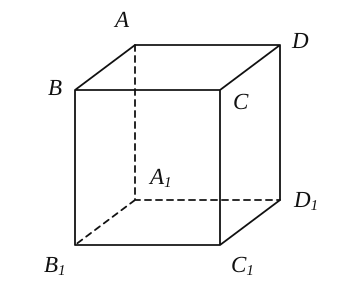

### 三、解答题

17. 如图，用一块钢锭浇铸一个厚度均匀、且表面积为 $2\,\mathrm{m}^2$ 的正四棱锥形有盖容器。设容器的高为 $h\,\mathrm{m}$，盖子的边长为 $a\,\mathrm{m}$。
    （1）求 $a$ 关于 $h$ 的函数表达式；❌（2）当 $h$ 为何值时，容器的容积 $V$ 最大？并求出 $V$ 的最大值。【均值不等式没用对！！】
    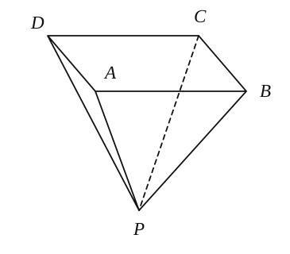
    
18. 如图，直三棱柱 $ABC-A_1B_1C_1$ 的侧棱长为 $2$，底面 $\triangle ABC$ 是等腰直角三角形，$\angle ABC=90^\circ$，$AC=2$，求点 $C_1A_1$ 与平面 $A_1BC$ 所成的角的大小。
    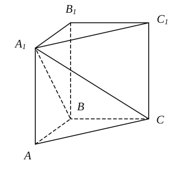

19. 如图，已知线段 $AB$ 垂直于三角形 $BCD$ 所在的平面，且 $AB=BC=CD=1$，$\angle BCD=90^\circ$，$BE\perp AD$，$E$ 为垂足，$F$ 为 $AC$ 的中点，求 $EF$ 的长。
    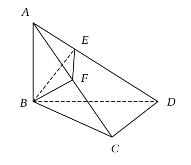

20. 已知 $ABCD-A_1B_1C_1D_1$ 是底面边长为 $1$ 的正四棱柱，$O_1$ 为 $A_1C_1$ 与 $B_1D_1$ 的交点。
    （1）设 $AB_1$ 与底面 $A_1B_1C_1D_1$ 所成角的大小为 $\alpha$，二面角 $A-B_1D_1-A_1$ 的大小为 $\beta$。求证：$\tan\beta=\sqrt{2}\tan\alpha$；
    （2）若点 $C$ 到平面 $AB_1D_1$ 的距离为 $\dfrac{4}{3}$，求正四棱柱 $ABCD-A_1B_1C_1$ 的高。
    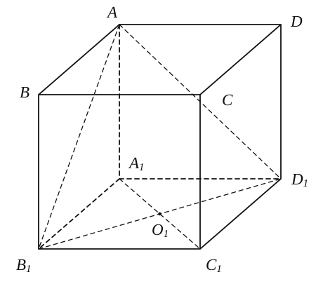

21. 如图，几何体 $\Omega$ 为一个圆柱和圆锥的组合体，圆锥的底面和圆柱的一个底面重合，圆锥的顶点为 $P$，圆柱的上、下底面的圆心分别为 $O_1$、$O_2$，且该几何体有半径为 $1$ 的外接球（即圆锥的顶点与底面圆周在球面上，且圆柱的底面圆周也在球面上），外接球球心为 $O$。
    （1）若圆柱的底面圆半径为 $\dfrac{\sqrt{3}}{2}$，求几何体 $\Omega$ 的体积；
    （2）若 $PO_1:O_1O_2=1:3$，求几何体 $\Omega$ 的表面积。
    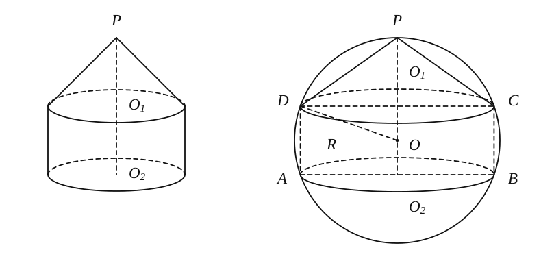
