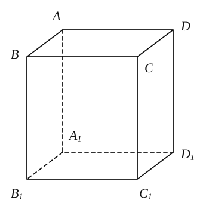
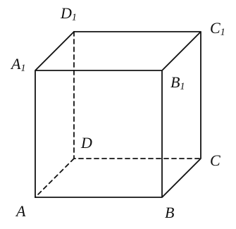
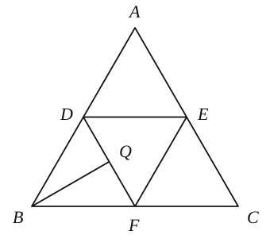
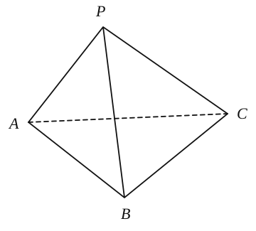
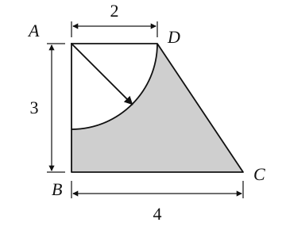
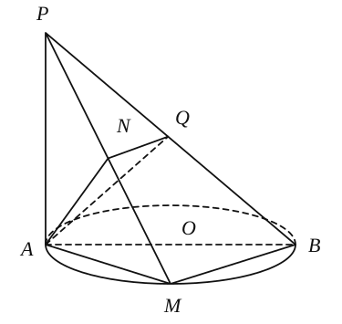
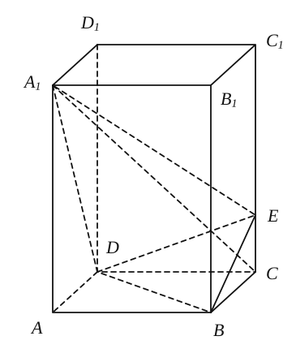
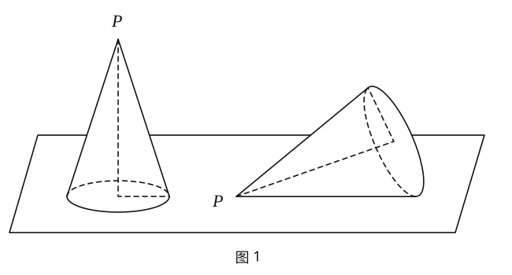
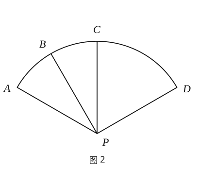

## 20261029 高二数学期中复习 5

### 一、填空题

1. 已知球的体积为 $36\pi$，则该球的大圆的面积为 \_\_\_\_\_\_\_\_\_\_\_\_\_\_\_\_。

2. 若 $l$、$m$ 是两条不同的直线，$m$ 垂直于平面 $\alpha$，则“$l\parallel\alpha$”是“$l\perp m$”的 \_\_\_\_\_\_\_\_\_\_\_\_\_\_\_\_ 条件。

3. 已知向量 $\vec{a}=(0,2,1)$，$\vec{b}=(-1,-1,0)$，则 $\vec{a}$ 与 $\vec{b}$ 的夹角为 \_\_\_\_\_\_\_\_\_\_\_\_\_\_\_\_。

4. 已知 $\triangle ABC$ 是腰长为 $2$ 的等腰直角三角形，那么 $\triangle ABC$ 的斜二测平面直观图的面积是 \_\_\_\_\_\_\_\_\_\_\_\_\_\_\_\_。

5. 已知三棱柱 $ABC-A_1B_1C$ 的体积为 $6$，则四面体 $C-A_1BC_1$ 的体积为 \_\_\_\_\_\_\_\_\_\_\_\_\_\_\_\_。

6. 过圆柱的上、下底面圆圆心的平面截圆柱所得的截面是面积为 $8$ 的正方形，则圆柱的侧面积是 \_\_\_\_\_\_\_\_\_\_\_\_\_\_\_\_。

7. 已知正四棱柱的对角线长为 $2\sqrt{3}$，且对角线与底面所成角的余弦值为 $\dfrac{\sqrt{6}}{3}$，则这个正四棱柱的体积等于 \_\_\_\_\_\_\_\_\_\_\_\_\_\_\_\_。  

8. 点 $P$ 是棱长为 $1$ 的正方体 $ABCD-A_1B_1C_1D_1$ 的底面 $A_1B_1C_1D_1$ 的中心，则 $\left|\overrightarrow{PA}+\overrightarrow{PC_1}\right|=$ \_\_\_\_\_\_\_\_\_\_\_\_\_\_\_\_。  

9. 如图是各棱长均相等的某三棱锥表面展开图，$Q$ 是 $DF$ 的中点；则在原三棱锥中 $BQ$ 与 $EF$ 所成角的余弦值为 \_\_\_\_\_\_\_\_\_\_\_\_\_\_\_\_。 

10. 有下列命题中正确的是 \_\_\_\_\_\_\_\_\_\_\_\_\_\_\_\_（填号）：
    ① 在圆柱的上、下底面的圆周上各取一点，则这两点的直线距离是圆柱的母线长；
    ② 圆锥的顶点与底面圆周上任意一点的连线是圆锥的母线长；
    ③ 侧面都是平行四边形的多面体是棱柱；
    ④ 体对角线相等 平行六面体是长方体。

11. 两个圆锥有等长的母线，它们的侧面展开图恰好拼成一个圆，若它们的侧面积之比为 $1:2$，则它们的体积比是 \_\_\_\_\_\_\_\_\_\_\_\_\_\_\_\_。

12. 已知三棱锥 $P-ABC$，若 $PA$、$PB$、$PC$ 两两互相垂直，且 $PA=PB=1$，$PC=2$，$D$ 为面 $ABC$ 上的动点，则 $PD$ 的最小值为 \_\_\_\_\_\_\_\_\_\_\_\_\_\_\_\_。

### 二、选择题

13. 若球的表面积是原来的 $9$ 倍，则球的体积为原来的（　　）倍。

    A. $3\sqrt{3}$　　                B. $9$　　                    C. $27$　　           D. $9\sqrt{3}$

14. 矩形的边长分别为 $1$ 和 $2$，分别以这两边为轴旋转，所形成的几何体的侧面积之比为（　　）。

    A. $1:2$　　                 B. $1:1$　　               C. $1:4$　　       D. $4:1$

15. 下列命题中正确的命题的个数为（　　）。

    ① 一条直线与两个平行平面中的一个平面相交，必与另外一个平面相交；

    ② 如果一个平面平行于两个平行平面中的一个平面，必平行于另一个平面；

    ③ 若两个平面平行，则其中一个平面内的任一直线平行于另一平面。

    A. $1$　　                       B. $2$　　                   C. $3$　　          D. $0$

16. 已知四棱锥 $P-ABCD$ 的底面 $ABCD$ 是边长为 $2$ 的正方形，且 $\angle PAB=90^\circ$。若四棱锥 $P-ABCD$ 的五个顶点在以 $4$ 为半径的同一球面上，当 $PA$ 最长时，则四棱锥 $P-ABCD$ 的体积为（　　）。

    A. $\dfrac{4\sqrt{45}}{3}$　　              B. $\dfrac{4\sqrt{41}}{3}$　　          C. $\dfrac{8\sqrt{14}}{3}$　　      D. $\dfrac{8\sqrt{15}}{3}$

### 三、解答题

17. 在三棱锥 $P-ABC$ 中，已知 $PA=PB=PC=AC=AB=10$，$BC=12$。取 $BC$ 中点 $M$，联结 $PM$、$AM$。
    （1）求证：$BC\perp$ 平面 $PAM$；
    （2）求此三棱锥的体积。
    

18. 如图，四边形 $ABCD$ 为梯形，$AD\parallel BC$，$\angle ABC=90^\circ$，求图中阴影部分绕 $AB$ 旋转一周所形成的几何体的体积。
    

19. 如图，$AB$ 为 $\odot O$ 的直径，$PA$ 垂直于 $\odot O$ 所在的平面，$M$ 为圆周上任意一点，$AN\perp PM$，$N$ 为垂足；
    （1）求证：$AN\perp$ 平面 $PBM$；
    （2）若 $AQ\perp PB$，垂足为 $Q$，求证：$NQ\perp PB$。
    

20. 如图，正四棱柱 $ABCD-A_1B_1C_1D_1$ 中，$AA_1=2AB=4$，点 $E$ 在 $CC_1$ 上且 $C_1E=3EC$。
    （1）求直线 $A_1D$ 与平面 $BED$ 所成角的大小；
    （2）求点 $A_1$ 到平面 $BED$ 的距离。
    

21. 用一个半径为 $12$ 厘米、圆心角为 $\dfrac{2\pi}{3}$ 的扇形纸片 $PAD$ 卷成一个侧面积最大的无底圆锥（接口不用考虑损失），放于水平面上。
    （1）无底圆锥被一阵风吹倒后（如图 $1$），求它的最高点到水平面的距离；
    （2）扇形纸片 $PAD$ 上（如图 $2$），$C$ 是弧 $AD$ 的中点，$B$ 是弧 $AC$ 的中点，卷成无底圆锥后，求异面直线 $PA$ 与 $BC$ 所成角的大小。
        
