## 20261030 高二数学期中复习 6

### 一、填空题

1. 若 $a$、$b$ 是异面直线，直线 $c\parallel a$，则 $c$ 与 $b$ 的位置关系是 \_\_\_\_\_\_\_\_\_\_\_\_\_\_\_\_。

2. 一个球的半径为 $3\,\mathrm{m}$，它的表面积为 \_\_\_\_\_\_\_\_\_\_\_\_\_\_\_\_ $\mathrm{m}^2$。

3. 直线 $PA$ 与平面 $\alpha$ 所成角为 $\dfrac{\pi}{4}$，则直线 $PA$ 与平面 $\alpha$ 内的任意一条直线所成角的取值范围是 \_\_\_\_\_\_\_\_\_\_\_\_\_\_\_\_。

4. 边长为 $4$ 的正方形绕其一边所在的直线旋转一周，所得的几何体的体积为 \_\_\_\_\_\_\_\_\_\_\_\_\_\_\_\_。

5. 在空间直角坐标系 $O-xyz$ 中，点 $P(1,2,4)$ 到 $Ox$ 轴的距离为 \_\_\_\_\_\_\_\_\_\_\_\_\_\_\_\_。

6. 圆锥的侧面展开图恰好是一个半圆，则该圆锥的母线与底面所成的角的大小为 \_\_\_\_\_\_\_\_\_\_\_\_\_\_\_\_。

7. 在棱长为 $2$ 的正方体 $ABCD-A_1B_1C_1D_1$ 中，直线 $B_1C_1$ 到平面 $A_1D_1C$ 的距离为 \_\_\_\_\_\_\_\_\_\_\_\_\_\_\_\_。

    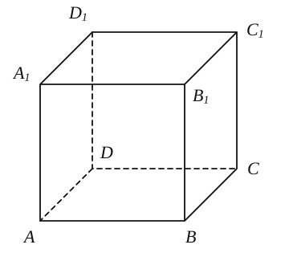

8. 如图，若正四棱锥的底面边长为 $2\sqrt{3}\,\mathrm{cm}$，体积为 $4\,\mathrm{cm}^3$，则它的侧棱与底面所成的角的大小是 \_\_\_\_\_\_\_\_\_\_\_\_\_\_\_\_。

    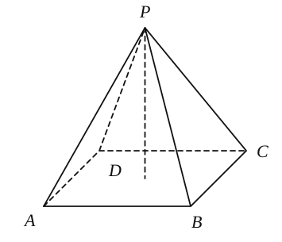

9. 在正方体 $ABCD-A_1B_1C_1D_1$ 中，二面角 $B_1-AC-D$ 的大小为 \_\_\_\_\_\_\_\_\_\_\_\_\_\_\_\_。

    

10. 在正四面体 $ABCD$ 中，点 $E$、$F$、$G$ 分别为棱 $BC$、$CD$、$AC$ 的中点，则异面直线 $AE$、$FG$ 所成角的余弦值为 \_\_\_\_\_\_\_\_\_\_\_\_\_\_\_\_。

    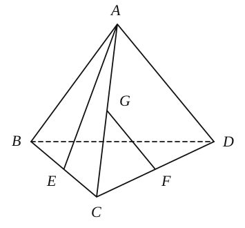

11. 已知 $\triangle ABC$ 中，$\angle ACB=90^\circ$，$\angle BAC=30^\circ$，$BC=5$，$PO\perp$ 平面 $ABC$，$O$ 为垂足，且 $PA=PB=PC=10$，则 $PO$ 的长等于 \_\_\_\_\_\_\_\_\_\_\_\_\_\_\_\_。

12. ❌如图，平面 $OAB\perp$ 平面 $\alpha$，$OA\subset\alpha$，$OA=AB$，$\angle OAB=120^\circ$。平面 $\alpha$ 内一点 $P$ 满足 $PA\perp PB$，记直线 $OP$ 与平面 $OAB$ 所成角为 $\theta$，则 $\tan\theta$ 的最大值是 \_\_\_\_\_\_\_\_\_\_\_\_\_\_\_\_。【无思路】

    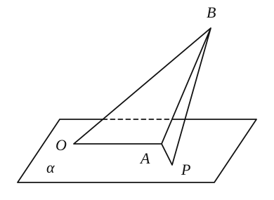

### 二、选择题

13. 当我们停放自行车时，只要将自行车旁的撑脚放下，自行车就稳了，这用到了（　　）。

    A. 三点确定一平面　　B. 不共线三点确定一平面  
    C. 两条相交直线确定一平面　　D. 两条平行直线确定一平面

14. 如右图，正方体 $A_1B_1C_1D_1-ABCD$ 中，$E$、$F$ 分别为棱 $A_1A$、$BC$ 上的点，在平面 $ADD_1A_1$ 内且与平面 $DEF$ 平行的直线（　　）。

    A. 有一条　　B. 有二条　　C. 有无数条　　D. 不存在

    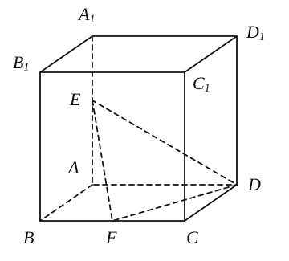

15. 设直线 $m$ 与平面 $\alpha$ 相交但不垂直，则下列说法中正确的有（　　）个。

    ① 在平面 $\alpha$ 内有且只有一条直线与直线 $m$ 垂直。

    ② 过直线 $m$ 有且只有一个平面与平面 $\alpha$ 垂直。

    ③ 与直线 $m$ 垂直的直线可能与平面 $\alpha$ 平行。

    ④ 与直线 $m$ 平行的平面可能与平面 $\alpha$ 垂直。

    A. $0$　　B. $1$　　C. $2$　　D. $3$

16. 如右图，四棱锥 $P-ABCD$ 底面为正方形，侧面 $PAD$ 为等边三角形，且侧面 $PAD\perp$ 底面 $ABCD$，点 $M$ 在底面正方形 $ABCD$ 内运动，且满足 $MP=MC$，则点 $M$ 在正方形 $ABCD$ 内的轨迹一定是（　　）。

    | A | B | C | D |
    | :---: | :---: | :---: | :---: |
    | 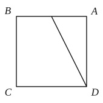 | 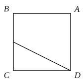 | 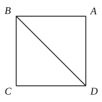 | 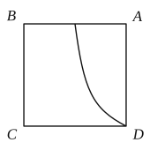 |

    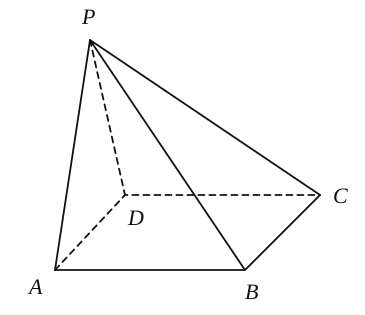

### 三、解答题

17. 在半径为 $13\,\mathrm{cm}$ 的球面上有 $A$、$B$、$C$ 三点，$AB=BC=AC=12\,\mathrm{cm}$，求球心到经过这三点的截面的距离。

18. 如图，圆锥的底面直径与母线长均为 $4$，点 $C$ 是底面直径 $AB$ 所对弧的中点，点 $D$ 是母线 $PA$ 的中点。

    （1）求该圆锥的侧面积与体积；

    （2）求直线 $CD$ 与平面 $PAB$ 所成角的大小。

    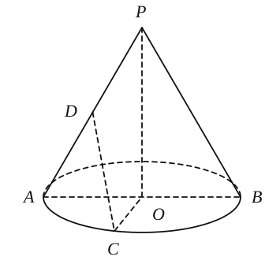

19. 如图，在长方体 $ABCD-A_1B_1C_1D_1$ 中，$AB=1$，$BC=2$，$CC_1=5$，$M$ 为棱 $CC_1$ 上一点，$C_1M=1$。

    （1）证明：$BM\perp$ 平面 $A_1B_1M$；

    （2）求异面直线 $A_1M$ 和 $C_1D$ 所成角的大小。

    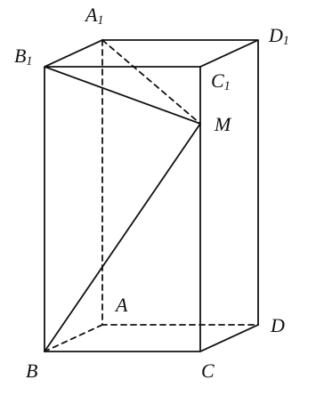

20. 四棱锥 $P-ABCD$ 中，底面 $ABCD$ 为等腰梯形，$PD\perp$ 平面 $ABCD$，$AB=2CD$，$PD=AD=CD=1$。

    （1）求异面直线 $PA$ 与 $BC$ 所成的角的大小；

    （2）求平面 $PDC$ 与平面 $PBC$ 所成的钝二面角的大小。

    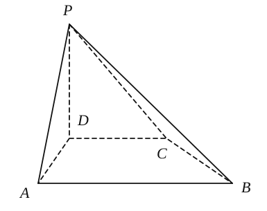

21. （1）求一个棱长为 $\sqrt{2}$ 的正四面体的体积，有如下解法，请你将它补充完成。

    解：构造一个棱长为 $1$ 的正方体（我们称之为该四面体的“生成正方体”），如图①：则四面体 $ACB_1D_1$ 为棱长是 \_\_\_\_\_\_\_\_\_\_\_\_\_\_\_\_ 的正四面体，且有

    $V_{\text{四面体}ACB_1D_1}=V_{\text{正方体}}-V_{B-ACB_1}-V_{A_1-AB_1D_1}-V_{C_1-B_1CD_1}-V_{D-ACD_1}=$ \_\_\_\_\_\_\_\_\_\_\_\_\_\_\_\_。（直接填在横线上）

    （2）模仿（1），对一个已知四面体，构造它的“生成平行六面体”，记两者的体积依次为 $V_{\text{四面体}}$ 和 $V_{\text{生成平行六面体}}$，试给出这两个体积之间的一个关系式，不必证明：

    \_\_\_\_\_\_\_\_\_\_\_\_\_\_\_\_。

    （3）如图②，一个相对的棱长都相等的四面体（通常称之为等腰四面体），其三组棱长分别为 $\sqrt{5}$、$\sqrt{13}$、$\sqrt{10}$，求此四面体的体积。

    | 图① | 图② |
    | :---: | :---: |
    | 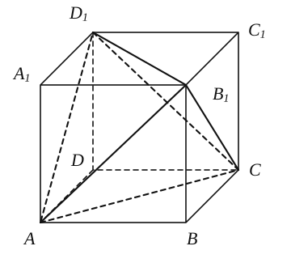 | 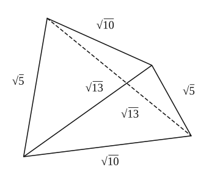 |
