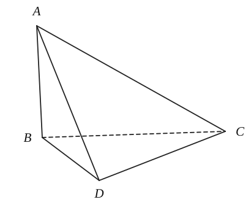
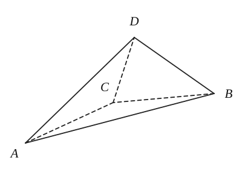
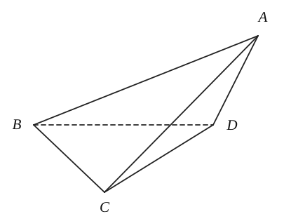

## 20261012 立体几何的外接球问题

球的体积公式：$\underline{\qquad\qquad}$；球的表面积公式：$\underline{\qquad\qquad}$。

### 例题

例1. 在《九章算术》中，将四个面都为直角三角形的三棱锥称之为鳖臑。如图，已知在鳖臑 $A-BCD$ 中，满足 $CD\perp$ 平面 $ABD$，且 $CD=AD=5$，$BD=3$，$AB=4$，则此鳖臑外接球的表面积为（　　）

A. $25\pi$　　B. $50\pi$　　C. $100\pi$　　D. $200\pi$

例2. 已知三棱锥 $A-BCD$ 中，且 $AB=CD=\sqrt{6}$，$BC=AD=2\sqrt{2}$，$AC=BD=\sqrt{10}$，则该三棱锥外接球的表面积为（　　）

A. $12\pi$　　B. $36\pi$　　C. $4\sqrt{3}\pi$　　D. $12\sqrt{3}\pi$

例3. 如图，在四面体 $ABCD$ 中，$\angle ACB=\angle ADB=90^\circ$，$AB=2$，则四面体 $ABCD$ 外接球的表面积为（　　）

A. $2\pi$　　B. $4\pi$　　C. $8\pi$　　D. $\dfrac{8\pi}{3}$

例4. 已知直三棱柱 $ABC-A_1B_1C_1$ 的顶点都在球 $O$ 上，若 $\angle ABC=90^\circ$，$AA_1=5$，$AB=3$，$BC=4$，则球 $O$ 的表面积为（　　）

A. $169\pi$　　B. $120\pi$　　C. $100\pi$　　D. $50\pi$

例5. 在三棱锥 $P-ABC$ 中，$PA\perp$ 平面 $ABC$，$\angle BAC=\dfrac{2\pi}{3}$，$AB=AC=2\sqrt{3}$，$PA=2$，则该三棱锥外接球的表面积为 $\underline{\qquad\qquad}$。

例6. 正三棱锥 $P-ABC$ 中，$AB=3\sqrt{3}$，侧棱 $PC=3\sqrt{2}$，则三棱锥 $P-ABC$ 的外接球体积为 $\underline{\qquad\qquad}$。

A. $48\pi$　　B. $12\pi$　　C. $24\pi$　　D. $36\pi$

例7. 在三棱锥 $A-BCD$ 中，$AB=AD=BD=\sqrt{2}$，$BC=CD=1$，若平面 $ABD\perp$ 平面 $CBD$，则三棱锥 $A-BCD$ 外接球表面积为（　　）

A. $\dfrac{16\pi}{3}$　　B. $\dfrac{8\pi}{3}$　　C. $\dfrac{4\sqrt{3}\pi}{3}$　　D. $2\pi$

### 练习

1. 如图，在三棱锥 $A-BCD$ 中，$\triangle ABD$ 和 $\triangle BCD$ 都是等腰三角形，且 $\angle ADB=120^\circ$，$BC\perp BD$，$BD=4$，二面角 $A-BD-C$ 的大小为 $150^\circ$，则三棱锥 $A-BCD$ 外接球的表面积为（　　）

   A. $112\pi$　　B. $116\pi$　　C. $448\pi$　　D. $464\pi$

   

2. 在正三棱台 $ABC-A_1B_1C_1$ 中，$AB=4$，$A_1B_1=B_1B=2$，则该正三棱台外接球的表面积为（　　）

   A. $32\pi$　　B. $28\pi$　　C. $22\pi$　　D. $12\pi$

3. 已知球 $O$ 的体积为 $4\sqrt{3}\pi$，$A$、$B$、$C$、$D$ 四点均在球 $O$ 的球面上，$\triangle ABC$ 为等边三角形，$DA=DB=DC=\sqrt{2}$，则 $\triangle ABC$ 的面积为（　　）

   A. $\dfrac{5\sqrt{3}}{4}$　　B. $\dfrac{2\sqrt{3}}{5}$　　C. $\dfrac{4}{9}$　　D. $4\sqrt{3}$

4. 已知点 $S,A,B,C$ 均在半径为 $3$ 的球面上，$\triangle ABC$ 是边长为 $3$ 的等边三角形，$SA\perp$ 平面 $ABC$，则 $SA=\underline{\qquad\qquad}$。
