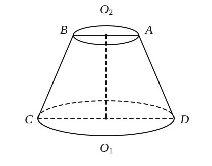
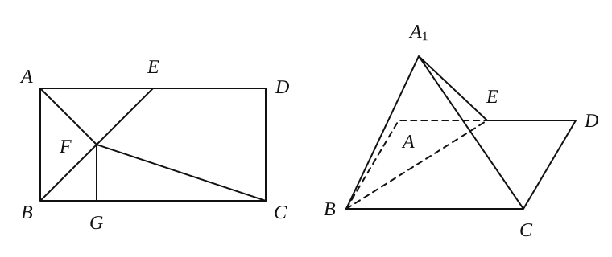
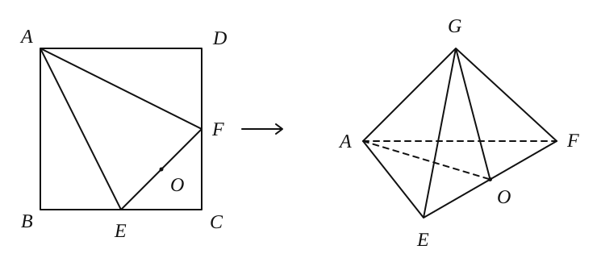
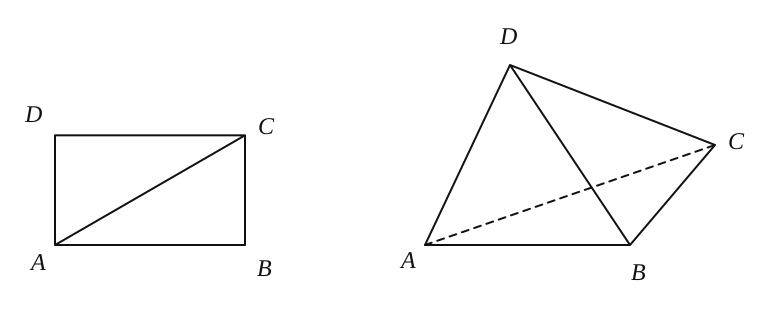
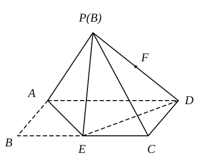
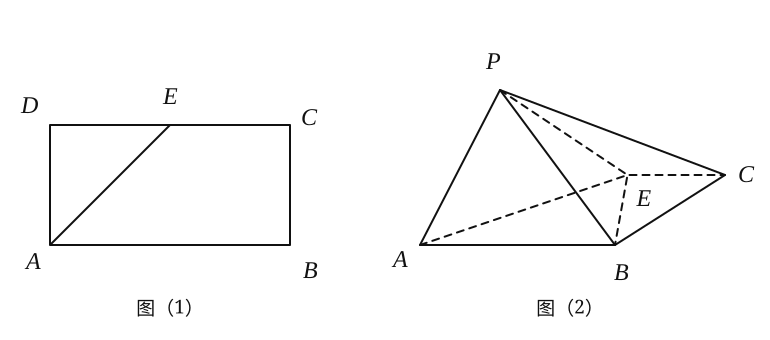
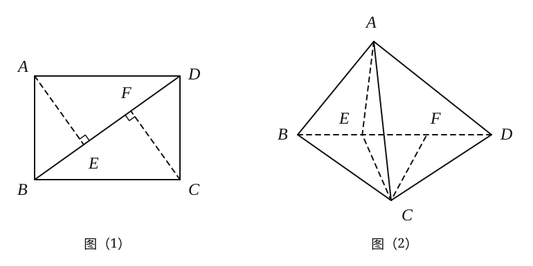
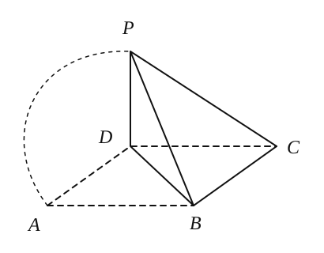

## 20261019 立体几何中的折叠问题

### 知识点：折叠问题

**1. 概念**

将平面图形沿某直线翻折成立体图形，再对折叠后的立体图形的线面位置关系和某几何量进行论证和计算，就是折叠问题。

**2. 折叠问题的核心逻辑：“==变与不变==”**

翻折前后，线段长度、角度的大小若在同一平面内则保持不变，空间位置关系（如垂直、平行）可能发生变化。

**3. 折叠问题分析求解原则**

（1）折叠问题的探究须充分利用不变量和不变关系。

（2）折叠前后始终位于折线的同侧的几何量和位置关系保持不变。

**4. 翻折的基本性质**

（1）翻折前后全等，折叠前后图形形状、大小不变，对应边相等、对应角相等。

（2）对称轴是折痕，折痕是对应点连线的垂直平分线。

（3）对应点连线垂直于折痕，且被折痕垂直平分。

（4）折叠前后重合线段相等、重合角相等。

### 典型例题

**例 1** 某班级到一工厂参加社会实践劳动，加工出如图所示的圆台 $O_1O_2$，在轴截面 $ABCD$ 中，$AB=AD=BC=2\,\mathrm{cm}$，且 $CD=2AB$，则一只小虫从点 $C$ 沿着该圆台的侧面爬行到点 $D$ 所经过的最短路程为 \_\_\_\_\_\_\_\_\_\_\_\_\_\_\_\_。

**例 2** 如图，矩形 $ABCD$ 中，$AB=2$，$AD=4$，$E$ 为边 $AD$ 的中点，将 $\triangle ABE$ 沿直线 $BE$ 翻折至 $\triangle A_1BE$ 位置，使得二面角 $A_1-BE-C$ 的大小为 $\dfrac{\pi}{2}$，则 $A_1C=$ \_\_\_\_\_\_\_\_\_\_\_\_\_\_\_\_。

**例 3** 如图，在正方形 $ABCD$ 中，$E$、$F$ 分别是 $BC$、$CD$ 的中点，现在沿 $AE$、$AF$ 及 $EF$ 把这个正方形折成一个空间图形，使 $B$、$C$、$D$ 三点重合，重合后的点记为 $G$，且取 $EF$ 中点为 $O$，则在这个空间图形中必有（　　）。
A. $AO\perp OG$　　                                B. $AE\perp AF$  
C. $AG\perp OG$　　                                 D. $AE\perp OG$

**例 4** 已知矩形 $ABCD$，$AB=\sqrt{3}$，$BC=1$，将 $\triangle ADC$ 沿对角线 $AC$ 进行翻折，得到三棱锥 $D-ABC$，则在翻折过程中，下面四个命题错误的是（　　）。
A. 三棱锥 $D-ABC$ 的体积最大值为 $\dfrac{1}{4}$  
B. 三棱锥 $D-ABC$ 的外接球体积不变  
C. 异面直线 $AB$ 与 $CD$ 所成角的最大值为 $90^\circ$  
D. $AD$ 与平面 $ABC$ 所成角的最大值为 $60^\circ$

**例 5** 如图，长方形 $ABCD$ 中，$AB=2$，$BC=4$，$E$ 为 $BC$ 的中点，现将 $\triangle BAE$ 沿 $AE$ 向上翻折到 $\triangle PAE$ 的位置，连接 $PC$、$PD$，在翻折的过程中（从初始位置开始，直到点 $B$ 再次落到平面 $ACD$ 内），点 $P$ 到平面 $ACD$ 距离的最大值为 \_\_\_\_\_\_\_\_\_\_\_\_\_\_\_\_，$PD$ 的中点 $F$ 的轨迹长度为 \_\_\_\_\_\_\_\_\_\_\_\_\_\_\_\_。

### 配套练习

**1.** 如图（1），在矩形 $ABCD$ 中，$AB=2AD$，$E$ 是 $CD$ 的中点，将 $\triangle ADE$ 沿 $AE$ 折起，使点 $D$ 到达点 $P$ 的位置，并满足 $PA\perp PB$，如图（2），则下列结论错误的是 \_\_\_\_\_\_\_\_\_\_\_\_\_\_\_\_。

A. 平面 $PAB\perp$ 平面 $PBE$  
B. 平面 $PAE\perp$ 平面 $PBE$  
C. 平面 $PAB\perp$ 平面 $ABCE$  
D. 平面 $PAE\perp$ 平面 $ABCE$

**2.** 已知矩形 $ABCD$ 中，$AB=\sqrt{2}$，$BC=2$，将 $\triangle ABD$ 沿矩形对角线 $BD$ 所在直线进行翻折，则下列说法正确的是（　　）。

A. 存在某个位置，使得直线 $AB$ 与直线 $CD$ 垂直  
B. 存在某个位置，使得直线 $AC$ 与直线 $BD$ 垂直  
C. 存在某个位置，使得直线 $AD$ 与直线 $BC$ 垂直  
D. 对任意位置，$AB$ 与 $CD$、$AC$ 与 $BD$、$AD$ 与 $BC$ 都不垂直

**3.** 已知平行四边形 $ABCD$ 中，$BC\perp BD$，将 $\triangle ABD$ 沿着 $BD$ 翻折使点 $A$ 到达点 $P$ 且 $P$ 不在平面 $BCD$ 内，则下列结论正确的是（　　）。

A. 直线 $BC$ 不可能与直线 $PB$ 垂直  
B. 直线 $CD$ 可能与直线 $PB$ 垂直  
C. 直线 $BD$ 可能与直线 $PB$ 垂直  
D. 直线 $BC$ 不可能与直线 $PD$ 垂直

