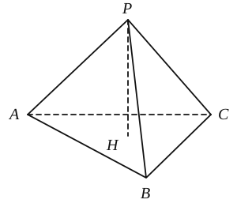
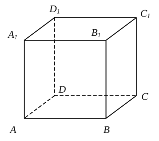
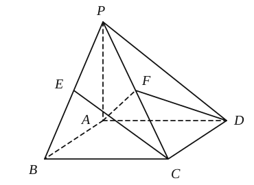
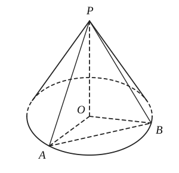
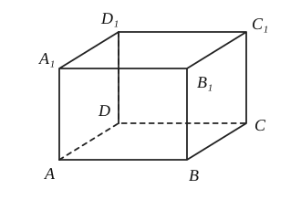
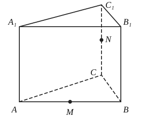
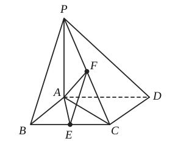
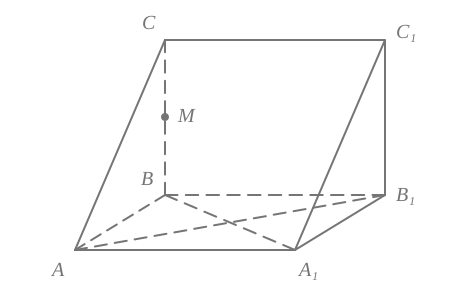

# 第 1 章 平面直角坐标系中的直线

## 20261106 直线的倾斜角斜率

### 课堂练习

1. 直线 $l$ 过点 $A(3,7)$，$B(3,-9)$，则直线 $l$ 的倾斜角为 \_\_\_\_\_\_\_\_\_\_\_\_\_\_\_\_

2. 直线 $\dfrac{x+1}{4}+\dfrac{y-9}{3}=0$ 的斜率为 \_\_\_\_\_\_\_\_\_\_\_\_\_\_\_\_，倾斜角为 \_\_\_\_\_\_\_\_\_\_\_\_\_\_\_\_。

3. 过点 $A(-1,t)$，$B(t,2)$ 的直线 $AB$ 的倾斜角为 $\arctan\dfrac{2}{3}$，则实数 $t$ 的值为 \_\_\_\_\_\_\_\_\_\_\_\_\_\_\_\_

4. 过点 $(1,2)$ 且倾斜角的正弦值是 $\dfrac{3}{5}$ 的直线方程为 \_\_\_\_\_\_\_\_\_\_\_\_\_\_\_\_

5. 已知三个不同的点 $A(2,a)$、$B(a+1,2a+1)$、$C(-4,1+a)$ 在同一条直线上。求实数 $a$ 的值及该直线的斜率。

6. 在平面直角坐标系中有一个边长为 $1$ 的正方形 $OABC$，其中点 $O$ 为坐标原点，点 $A$、$C$ 分别在 $x$ 轴和 $y$ 轴上，点 $B$ 在第一象限，求直线 $OB$ 和 $AC$ 的方程。

### 一、填空题

1. 直线 $l$ 与向量 $\vec{d}=(\sqrt{3},-2)$ 平行，则 $l$ 的斜率为 \_\_\_\_\_\_\_\_\_\_\_\_\_\_\_\_。

2. 直线 $x=\tan\dfrac{\pi}{4}$ 的倾斜角为 \_\_\_\_\_\_\_\_\_\_\_\_\_\_\_\_。

3. 经过两点 $A(-2,2)$，$B(5,3)$ 的直线的倾斜角为 \_\_\_\_\_\_\_\_\_\_\_\_\_\_\_\_。

4. 直线 $l$ 与向量 $\vec{d}=(3,0)$ 垂直，则 $l$ 的倾斜角是 \_\_\_\_\_\_\_\_\_\_\_\_\_\_\_\_。

5. 斜率为 $2$，过点 $(-2,5)$ 的直线方程为 \_\_\_\_\_\_\_\_\_\_\_\_\_\_\_\_。

6. 过点 $A(1-a,1+a)$，$B(3,2a)$ 的直线的倾斜角为钝角，则实数 $a$ 的取值范围是 \_\_\_\_\_\_\_\_\_\_\_\_\_\_\_\_。

### 二、选择题

7. 若直线 $l$ 的倾斜角是 $\alpha$，且满足 $-1\leq\tan\alpha\leq 1$，则 $\alpha$ 的取值范围是（　　）

   A. $-\dfrac{\pi}{4}\leq\alpha\leq\dfrac{\pi}{4}$　　                                    B. $\dfrac{\pi}{4}\leq\alpha\leq\dfrac{3\pi}{4}$  
   C. $0\leq\alpha\leq\dfrac{\pi}{4}$　　                                         D. $0\leq\alpha\leq\dfrac{\pi}{4}$ 或 $\dfrac{3\pi}{4}\leq\alpha<\pi$

8. 过点 $A(4,0)$，$B(0,3)$ 的直线的倾斜角大小是（　　）

   A. $\arctan\dfrac{3}{4}$　　  B. $\pi-\arctan\dfrac{3}{4}$        C. $\arctan\left(-\dfrac{3}{4}\right)$　　D. $\pi-\arctan\left(-\dfrac{3}{4}\right)$

### 三、解答题

9. 已知 $A(-2,3)$、$B(3,0)$，直线 $L$ 过 $O(0,0)$ 且与线段 $AB$ 相交，求直线 $L$ 的斜率的取值范围。

10. 直线 $l$ 过点 $(0,2)$，且与向量 $\vec{d}=(3,4)$ 平行，求直线 $l$ 的点斜式方程。

11. 已知直线 $l_1:y=2x-1$ 与 $x$ 轴的交点为 $M$，将直线 $l_1$ 绕点 $M$ 逆时针旋转 $\dfrac{\pi}{4}$ 得到直线 $l_2$，求直线 $l_2$ 的斜率 $k$ 及其方程。

12. ❌已知 $A(-3,2)$、$B(a,3)$，求直线 $AB$ 的斜率与倾斜角。【arctan的图像是啥？】

### 《天天练》

1. ❌侧棱长为 $2\sqrt{3}a$ 的正三棱锥 $S-ABC$ 的侧棱间的夹角为 $40^\circ$，过顶点 $A$ 作截面 $AEF$，截面 $AEF$ 的最小周长为 \_\_\_\_\_\_\_\_\_\_\_\_\_\_\_\_。【==没想到关键点==】

2. 已知 $a$、$b$ 是异面直线，给出以下四个命题，其中真命题的序号是 \_\_\_\_\_\_\_\_\_\_\_\_\_\_\_\_

   ① 过空间任意一点，必存在与 $a$、$b$ 都平行的平面

   ② 过空间任意一点，必存在与 $a$、$b$ 都相交的直线

   ③ 过空间任意一点有且仅有一条与 $a$、$b$ 都垂直的直线

   ④ 过直线 $a$ 有且仅有一个与 $b$ 平行的平面

3. 正三棱锥的一个侧面的面积等于它的底面正三角形面积的 $\dfrac{2}{3}$，则三棱锥的侧面与底面所成角的大小为 \_\_\_\_\_\_\_\_\_\_\_\_\_\_\_\_。

   

4. 《九章算术》中将四个面都是直角三角形的四面体称为“鳖臑”，则以正方体 $ABCD-A_1B_1C_1D_1$ 的顶点为顶点的“鳖臑”的个数为 \_\_\_\_\_\_\_\_\_\_\_\_\_\_\_\_

   

5. 如图，在四棱锥 $P-ABCD$ 中，底面 $ABCD$ 是矩形，$PA\perp$ 平面 $ABCD$，$PB$、$PD$ 与平面 $ABCD$ 所成的角依次是 $45^\circ$ 和 $\arctan\dfrac{1}{2}$，$AP=2$，$E$、$F$ 依次是 $PB$、$PC$ 的中点。

   （1）求三棱锥 $P-AFD$ 的体积。

   （2）求直线 $EC$ 与平面 $AFD$ 所成的角（结果用反三角函数值表示）；

   

## 20261109 直线的方程-1

### 课堂练习

1. 根据下列方程，求直线的斜率、倾斜角和法向量：
   （1）$x=1$；                        （2）$y=1$；
   （3）$x+y-1=0$；          （4）$x+2y-1=0$。

2. 已知直线 $l$ 的方程是 $(2a-3)x+(a+5)y-3=0$。根据下列条件，分别求实数 $a$ 的值：
   （1）$l$ 在 $y$ 轴上的截距为 $1$；
   （2）$l$ 的倾斜角为 $\dfrac{\pi}{4}$。

3. 已知直线 $l$ 的方程是 $(a-3)x+(2a+1)y-3=0$。求证：对于任意 $a\in\mathbb{R}$，直线 $l$ 均经过定点，并求此定点的坐标。

4. 直线 $l:y=kx+b$（$k,b\in\mathbb{R}$）与线段 $AB$ 相交，其中点 $A$ 为 $(4,2)$，点 $B$ 为 $(1,5)$。
   （1）当 $b=-1$ 时，求 $k$ 的取值范围；
   （2）当 $k=1$ 时，求 $b$ 的取值范围。

### 作业
1. 已知直线 $l$ 经过点 $P(3,5)$，倾斜角为 $\alpha$ 且 $\cos\alpha=\dfrac{3}{5}$。求直线 $l$ 的点斜式方程。

2. 已知直线 $l$ 在 $y$ 轴上的截距为 $4$，倾斜角为 $\alpha$ 且 $\sin\alpha=\dfrac{3}{5}$。求直线 $l$ 的斜截式方程。

3. 求下列直线的斜率与在 $x$ 轴、$y$ 轴上的截距：
   （1）$l_1:y+1=-\dfrac{\sqrt{3}}{3}(x+1)$；
   （2）$l_2:y=-3x+\sqrt{3}$。

4. 已知直线 $l:y=kx+2$ 经过点 $(1,-3)$。
   （1）求 $l$ 的倾斜角的大小；
   （2）求 $l$ 在 $x$ 轴上的截距。

5. 直线 $l$ 经过点 $P(-2,1)$，在 $x$ 轴、$y$ 轴上的截距分别为 $a$、$b$，已知 $a+b=-2$。求直线 $l$ 的方程。

6. 已知直线 $l:ax+(4-2a)y-3=0$。根据下列条件，求实数 $a$ 的值：
    （1）$l$ 经过点 $(1,1)$；
    （2）$l$ 在两个坐标轴上的截距相等。

7. 已知 $\triangle ABC$ 的三个顶点的坐标分别为 $A(3,8)$、$B(3,-2)$、$C(-3,0)$。
    （1）求 $BC$ 边上的中线所在直线的方程；  （2）求 $BC$ 边上的高所在直线的方程。

8. 已知直线 $l$ 过点 $M(5,-1)$，与 $x$ 轴、$y$ 轴围成等腰直角三角形。求直线 $l$ 的方程。

### 《天天练》

1. 一圆锥的高与母线的夹角为 $45^\circ$，底面圆内一条长为 $2$ 的弦所对的圆心角为 $120^\circ$，二面角 $P-AB-O$ 的大小为 \_\_\_\_\_\_\_\_\_\_\_\_\_\_\_\_$^\circ$。
   

2. 长方体 $ABCD-A_1B_1C_1D_1$ 中，体对角线 $AC_1$ 与长方体的上面、右面和后面所成的角的大小分别为 $\alpha$、$\beta$、$\gamma$，则 $\cos^2\alpha+\cos^2\beta+\cos^2\gamma=$ \_\_\_\_\_\_\_\_\_\_\_\_\_\_\_\_。
   

3. ❌正三棱柱 $ABC-A_1B_1C_1$ 的底边长、侧棱长都是 $2$，$M$ 为 $AB$ 的中点，$N$ 为 $CC_1$ 的中点，则在棱柱表面上，从 $M$ 到 $N$ 的最短路程等于 \_\_\_\_\_\_\_\_\_\_\_\_\_\_\_\_。
   

4. 下列命题中，不正确的是（　　）
   A. 棱长都相等的长方体是正方体；                                B. 有两个相邻侧面为矩形的棱柱为直棱柱；
   C. 有两个侧面与底面垂直的棱柱为直棱柱；              D. 底面为平行四边形的四棱柱叫平行六面体。
   
5. 如图，已知四棱锥 $P-ABCD$，底面 $ABCD$ 为矩形，$PA=AB=2$，$AD=2AB$，$PA\perp$ 平面 $ABCD$，$E$、$F$ 分别是 $BC$、$PC$ 的中点。
   （1）求二面角 $F-AE-B$ 的大小；
   （2）求 $FD$ 与平面 $AEF$ 所成的角的大小。
   

## 20261110 直线的方程-2

### 【练习】

#### 一、填空题

1. 直线 $2x+3y=1$ 的斜率为 \_\_\_\_\_\_\_\_\_\_\_\_\_\_\_\_。

2. 已知直线 $l$ 经过原点，且与直线 $y=x+1$ 的夹角为 $45^\circ$，则直线 $l$ 的方程为 \_\_\_\_\_\_\_\_\_\_\_\_\_\_\_\_。

3. 设直线 $2x+(k-3)y-2k+6=0$ 过定点 $P$，则点 $P$ 的坐标为 \_\_\_\_\_\_\_\_\_\_\_\_\_\_\_\_。

4. 过点 $(1,2)$，且法向量为 $(3,-4)$ 的直线的点法向式方程为 \_\_\_\_\_\_\_\_\_\_\_\_\_\_\_\_。

5. 若直线过点 $A(1,2)$，且在两坐标轴上截距相等，则直线 $l$ 方程为 \_\_\_\_\_\_\_\_\_\_\_\_\_\_\_\_。

6. 已知两点 $A(-1,5)$，$B(4,-2)$，直线 $l:y=kx+1$，若直线 $l$ 与线段 $AB$ 相交，则 $k$ 的取值范围是 \_\_\_\_\_\_\_\_\_\_\_\_\_\_\_\_。

#### 二、解答题

7. 求过定点 $(2,1)$ 且倾斜角是直线 $x-y+1=0$ 的倾斜角的两倍的直线方程。

8. 设直线 $l$ 的方程为 $(a+1)x+y+2-a=0$（$a\in\mathbb{R}$），若 $l$ 在两坐标轴上的截距的绝对值相等，求直线 $l$ 的方程。

9. 已知直线 $l$ 与过点 $A(7,4)$、$B(-5,6)$ 的直线垂直，且过线段 $PQ$ 的中点，点 $P$ 的坐标为 $(-2,1)$，点 $Q$ 的坐标为 $(2,-3)$，求直线 $l$ 的点法向式方程。

10. ❌已知 $\triangle ABC$ 中，两个顶点的坐标分别为 $A(-2,1)$、$B(4,-3)$，点 $G(0,2)$ 是此三角形的重心。分别求 $BC$、$AC$ 边所在直线的方程。

11. ❌若 $2x_1+3y_1=1$ 且 $2x_2+3y_2=1$，求过两点 $A(x_1,y_1)$、$B(x_2,y_2)$ 的直线 $l$ 的方程。

12. 如图是一个 $W$ 形的霓虹灯，每边长都是 $2\,\mathrm{m}$，每相邻两边相交所成的锐角都是 $60^\circ$，试建立适当的平面直角坐标系，写出此霓虹灯的每条边在这个坐标系中的方程。   

13. 一根金属棒在 $30^\circ\mathrm{C}$ 时长 $14.205\,\mathrm{m}$，在 $60^\circ\mathrm{C}$ 时长 $14.211\,\mathrm{m}$，已知金属棒的长度 $y$（单位：$\mathrm{m}$）与温度 $x$（单位：$^\circ\mathrm{C}$）的关系可以用直线的方程表示。试写出这条直线的方程，并求 $80^\circ\mathrm{C}$ 时这根金属棒的长度。

### 《天天练》

#### 一、填空题

1. 直线 $l$ 经过点 $A(-2,0)$、$B(-5,3)$，则直线 $l$ 的倾斜角为 \_\_\_\_\_\_\_\_\_\_\_\_\_\_\_\_。

2. ❌若过点 $P(1-a,1+a)$ 和 $Q(3,2a)$ 的直线的倾角为钝角，则实数 $a$ 的取值范围是 \_\_\_\_\_\_\_\_\_\_\_\_\_\_\_\_。

3. ❌过点 $A(-2,m)$、$B(m,4)$ 的直线的倾斜角为 $\pi-\arctan\dfrac{1}{2}$，则实数 $m$ 的值为 \_\_\_\_\_\_\_\_\_\_\_\_\_\_\_\_。

4. 已知直线 $l$ 的倾斜角为 $\alpha$，且 $0\leq\alpha\leq\dfrac{3\pi}{4}$，则直线 $l$ 的斜率取值范围是 \_\_\_\_\_\_\_\_\_\_\_\_\_\_\_\_。

5. 若三点 $A(2,3)$、$B(3,-2)$、$C\left(\dfrac{1}{2},m\right)$ 共线，则 $m$ 的值是 \_\_\_\_\_\_\_\_\_\_\_\_\_\_\_\_。

6. 直线 $l$ 经过点 $P(-1,2)$，倾斜角的正弦值是 $\dfrac{4}{5}$，则该直线的点斜式方程为 \_\_\_\_\_\_\_\_\_\_\_\_\_\_\_\_。

7. 过点 $P(3,2)$ 且在 $x$ 轴上的截距是 $y$ 轴上截距的 $2$ 倍的直线方程是 \_\_\_\_\_\_\_\_\_\_\_\_\_\_\_\_。

8. 直线 $l$ 过点 $(1,2)$，且它的倾斜角等于 $A(3,-5)$ 与 $B(0,-9)$ 两点确定的直线倾斜角的 $2$ 倍，则直线 $l$ 的方程为 \_\_\_\_\_\_\_\_\_\_\_\_\_\_\_\_。

#### 二、解答题

9. 已知直线 $l:(a-1)x+(3-2a)y+a+1=0$。
   （1）若直线的斜率 $k\in[-1,2]$，求直线的倾斜角的范围。
   （2）求证：对任意实数 $a$，直线 $l$ 都经过一个定点。

10. 如图，在直三棱柱 $ABC-A_1B_1C_1$ 中，$BA\perp BC$。若 $BA=BC=BB_1=2$，$M$ 是棱 $BC$ 上的一动点。试确定点 $M$ 的位置，使点 $M$ 到平面 $A_1B_1C$ 的距离等于 $\dfrac{\sqrt{2}}{2}$。    

## 20261111 两条直线的相交、平行与重合

### 课堂练习

#### 一、填空题

1\. 若直线 $ax+2y+2=0$ 与直线 $3x-y-2=0$ 平行，那么 $a=$ \_\_\_\_\_\_\_\_\_\_\_\_\_\_\_\_
2\. 直线 $Ax+4y-1=0$ 与直线 $3x-y-C=0$ 重合的充要条件是 \_\_\_\_\_\_\_\_\_\_\_\_\_\_\_\_
4\. 通过点 $(-1,1)$，且与直线 $2x-3y+1=0$ 平行的直线方程为 \_\_\_\_\_\_\_\_\_\_\_\_\_\_\_\_。
5\. 已知直线 $l_1:ax+y+1=0$ 与直线 $l_2:x+ay+1=0$ 平行，则 $a=$ \_\_\_\_\_\_\_\_\_\_\_\_\_\_\_\_。
6\. 两条直线 $3x-4y+8=0$，$5x+3y-15=0$ 的交点坐标为 \_\_\_\_\_\_\_\_\_\_\_\_\_\_\_\_。
7\. 若直线 $y=-x+b$ 与直 $5x+3y-31=0$ 线的交点在第一象限，则实数 $b$ 的取值范围是 \_\_\_\_\_\_\_\_\_\_\_\_\_\_\_\_
8\. 直线 $(m+1)x-(2m-1)y+5m+4=0$ 恒过一个定点，则此定点坐标为 \_\_\_\_\_\_\_\_\_\_\_\_\_\_\_\_

#### 二、选择题
9\. 下列说法正确的是（　　）
A. 若直线 $l_1$ 与 $l_2$ 的斜率相等，则 $l_1\parallel l_2$
B. 若直线 $l_1$ 与 $l_2$ 的斜率都不存在，则 $l_1\parallel l_2$
C. 若直线 $l_1\parallel l_2$，则 $l_1$ 与 $l_2$ 的斜率相等
D. 若一条直线的斜率存在，另一条直线的斜率不存在，则它们一定相交

10\. 如果 $\{(x,y)\mid ax+y+b=0\}\cap\{(x,y)\mid x+ay+1=0\}=\phi$，则（　　）
A. $a=1$ 且 $b\ne 1$                   B. $a=-1$ 且 $b\ne -1$
C. $a=\pm 1$ 且 $b\ne\pm 1$             D. $a=1$ 且 $b\ne 1$ 或 $a=-1$ 且 $b\ne -1$

#### 三、解答题

11\. 已知点 $P(0,1)$，过 $P$ 求直线，使它夹在两条直线 $l_1:x-3y+10=0$ 与 $l_2:2x+y-8=0$ 间的线段被点 $P$ 平分，求这直线方程。

### 一、填空题

1\. 若直线 $2x-y-10=0$ 经过直线 $4x+3y-10=0$ 和 $ax+2y+8=0$ 的交点，则 $a=$ \_\_\_\_\_\_\_\_\_\_\_\_\_\_\_\_。
2\. 已知直线 $l_1:mx+y-m-1=0$ 和直线 $l_2:x+my-2m=0$。当 $m=$ \_\_\_\_\_\_\_\_\_\_\_\_\_\_\_\_ 时，$l_1\parallel l_2$。
3\. 过点 $M(4,1)$ 且垂直直线 $x+3y-1=0$ 的直线方程是 \_\_\_\_\_\_\_\_\_\_\_\_\_\_\_\_。
4\. ❌若直线 $2x-y+a=0$ 与直线 $ax-y+2=0$ 的交点在第一象限，则实数 $a$ 的取值范围 \_\_\_\_\_\_\_\_\_\_\_\_\_\_\_\_。
5\. 直线 $(m+1)x-(2m-1)y+5m-4=0$ 恒过一个定点，则此定点坐标为 \_\_\_\_\_\_\_\_\_\_\_\_\_\_\_\_。
6\. 若 $AB>0$，且 $BC<0$，则直线 $Ax+By+C=0$ 不经过第 \_\_\_\_\_\_\_\_\_\_\_\_\_\_\_\_ 象限。

### 二、选择题
7\. ❌直线 $l_1\parallel l_2$（$l_1$ 与 $l_2$ 不重合）是直线 $l_1$ 与 $l_2$ 的斜率相等的（　　）
A. 充分非必要条件                    B. 必要非充分条件
C. 充要条件                              D. 既非充分又非必要条件

8\. 直线 $3x-2y+m=0$ 和直线 $6x-4y+5=0$ 的位置关系是（　　）
A. 平行                                       B. 平行或重合
C. 重合                                       D. 既不平行也不重合

9\. 直线 $y=-ax+a+1$ 与直线 $x+ay-2a-2=0$ 平行的充要条件是（　　）
A. $a=\dfrac{1}{2}$                     B. $a=-\dfrac{1}{2}$                   C. $a=1$                  D. $a=-1$

10\. 已知三条直线 $l_1:2x+1=0$，直线 $l_2:mx+y=0$，直线 $l_3:x+my-1=0$。若这三条直线中有两条直线平行，则实数 $m$ 所有可能的值的个数为（　　）
A. $2$                   B. $3$                 C. $4$                     D. $5$

### 三、解答题

11\. 判断下列各组直线的位置关系，若它们相交，求其交点坐标。
（1）$l_1:2x+3y+4=0$，$l_2:4x+6y-1=0$。
（2）$l_1:3x+4y-5=0$，$l_2:3x-4y=0$。

12\. 讨论下列直线之间的位置关系。
$l_1:(m-2)x+y+m=0$，$l_2:3x+my+m+6=0$。

13\. 求与直线 $2x-3y+4=0$ 平行，且在两坐标轴上截距之和为 $5$ 的直线方程。

14\. $m$ 为何值时，$l_1:4x+y=4$，$l_2:mx+y=0$，$l_3:2x-3my=4$ 三条直线不能构成三角形？

15\. ❌设直线 $l$ 的方程为 $2x+(k-3)y-2k+2=0$（$k\ne 3$，$k\ne 1$），求该直线与坐标轴的正半轴所围成三角形面积的最小值。【少了当且仅当】

## 20261112 两条直线垂直的判定与夹角的求法-1

### 一、填空题

1\. 直线 $l_1:2x+y-3=0$ 与直线 $l_2:x-y-2=0$ 的夹角为 \_\_\_\_\_\_\_\_\_\_\_\_\_\_\_\_。

2\. $a_1a_2+b_1b_2=0$ 是两直线 $l_1:a_1x+b_1y+c_1=0$，$l_2:a_2x+b_2y+c_2=0$ 垂直的 \_\_\_\_\_\_\_\_\_\_\_\_\_\_\_\_ 条件。

3\. 直线 $y=2x$ 关于 $x$ 轴对称的直线方程为 \_\_\_\_\_\_\_\_\_\_\_\_\_\_\_\_。

4\. 过点 $A(1,\dfrac{\sqrt{3}}{3})$，且与直线 $x-\sqrt{3}y=0$ 所成夹角为 $\dfrac{\pi}{3}$ 的直线方程是 \_\_\_\_\_\_\_\_\_\_\_\_\_\_\_\_。

5\. 已知直线 $l_1:\sqrt{3}x+y=0$，$l_2:kx-y+1=0$，若 $l_1$ 和 $l_2$ 的夹角为 $60^\circ$，则 $k=$ \_\_\_\_\_\_\_\_\_\_\_\_\_\_\_\_。

6\. 已知点 $M$ 是直线 $l:2x-y-4=0$ 与 $x$ 轴的交点，把直线 $l$ 绕点 $M$ 顺时针旋转 $\dfrac{\pi}{4}$，得到的直线方程是 \_\_\_\_\_\_\_\_\_\_\_\_\_\_\_\_。

### 二、选择题

7\. 直线 $\sqrt{3}x+y-3=0$ 与直线 $x+2=0$ 的夹角是（　　）
A. $\dfrac{\pi}{6}$　　          B. $\dfrac{\pi}{3}$　        　C. $\dfrac{2\pi}{3}$　        　D. $\dfrac{5\pi}{6}$

8\. 已知直线 $l_1:x+y\sqrt{1-\cos\alpha}+b=0$，直线 $l_2:x\sin\alpha+y\sqrt{1+\cos\alpha}-4=0$，若 $\alpha\in(\pi,\dfrac{3\pi}{2})$，则 $l_1$ 与 $l_2$ 的位置关系是（　　）
A. 平行　　B. 垂直　　C. 平行或重合　　D. 相交但不一定垂直

9\. 从原点向直线 $l$ 引垂线，垂足为 $(a,b)$，且 $ab\ne 0$，则直线 $l$ 的方程为（　　）
A. $ax+by+a^2+b^2=0$　　B. $ax+by-a^2-b^2=0$　　C. $ax+by+a^2-b^2=0$　　D. $ax+by-a^2+b^2=0$

10\. 若方程 $f(x,y)=0$ 表示定直线 $l$，$M(x_0,y_0)$ 为不在 $l$ 上的定点，则方程 $f(x,y)-f(x_0,y_0)=0$ 一定是（　　）
A. 过点 $M$ 且与 $l$ 相交的直线　　B. 过点 $M$ 且与 $l$ 平行的直线　　C. 过点 $M$ 且与 $l$ 垂直的直线　　D. 以上均不对

### 三、解答题

11\. 求两直线 $2x-y+1=0$ 与 $x+y-5=0$ 夹角的正弦值。

12\. 已知直线 $l$ 过 $P(2,1)$ 且与 $l_1:4x-3y=0$ 的夹角为 $45^\circ$，求直线 $l$ 的方程。

13\. ❌$\triangle ABC$ 中，已知点 $A(3,-1)$ 和点 $B(10,5)$，$\angle B$ 的平分线所在直线方程为 $x-4y+10=0$，求 $BC$ 边所在直线方程。

14\. ❌已知 $P$ 是 $x$ 轴上一点，定点 $A(1,3)$，$B(3,1)$。若 $|PA|+|PB|$ 最小时，求 $P$ 的坐标。【初中，将军饮马的问题】

## 20261114 1113  点到直线的距离

### 一、填空题

1\. 若点 $P(-3,m-2)$ 到原点的距离是它到 $x$ 轴的 $2$ 倍，则 $m=$ \_\_\_\_\_\_\_\_\_\_\_\_\_\_\_\_。

2\. 经过点 $(3,-1)$ 且与点 $(4,2)$ 的距离等于 $3$ 的直线方程是 \_\_\_\_\_\_\_\_\_\_\_\_\_\_\_\_。

3\. 与直线 $6x-8y+3=0$ 垂直，且与原点距离等于 $1$ 的直线方程是 \_\_\_\_\_\_\_\_\_\_\_\_\_\_\_\_。

4\. 已知直线 $l_1$ 过点 $(1,0)$，直线 $l_2$ 过点 $(3,4)$，且 $l_1\parallel l_2$。若 $l_1$ 与 $l_2$ 的距离是 $2\sqrt{5}$，则直线 $l_1$ 的方程为 \_\_\_\_\_\_\_\_\_\_\_\_\_\_\_\_，则直线 $l_2$ 的方程为 \_\_\_\_\_\_\_\_\_\_\_\_\_\_\_\_。

5\. 与两平行直线 $5x-2y-6=0$，$10x-4y+2=0$ 等距离的点的轨迹方程是 \_\_\_\_\_\_\_\_\_\_\_\_\_\_\_\_。

6\. 过点 $(1,2)$ 且与原点距离最大的直线方程是 \_\_\_\_\_\_\_\_\_\_\_\_\_\_\_\_。

### 二、选择题

7\. 两平行直线 $3x+2y-3=0$ 和 $6x+4y+7=0$ 之间的距离等于（　　）

A. $\dfrac{4\sqrt{13}}{13}$　　B. $\dfrac{10\sqrt{13}}{13}$　　C. $\dfrac{\sqrt{13}}{26}$　　D. $\dfrac{\sqrt{13}}{2}$

8\. 若直线到点 $A(1,0)$ 与点 $B(4,2\sqrt{3})$ 的距离均为 $1$，那么这样的直线共有 \_\_\_\_\_\_\_\_\_\_\_\_\_\_\_\_ 条。（　　）

A. $1$　　B. $2$　　C. $3$　　D. $4$

9\. 若点 $P(-1,a)$ 到直线 $3x+y-6=0$ 的距离为 $\sqrt{10}$，则 $a$ 的值为（　　）

A. $19$　　B. $-1$　　C. $19$ 或 $-1$　　D. $9+\sqrt{10}$ 或 $9-\sqrt{10}$

10\. 若不重合的两点 $P(b-1,a+1)$ 与 $Q(a,b)$ 关于直线 $l$ 对称，则直线 $l$ 的方程是（　　）

A. $x-y=0$　　B. $x-y+1=0$　　C. $x+y=0$　　D. $x+y+1=0$

### 三、解答题

11\. 直线 $l$ 过两直线 $3x+4y-5=0$ 和 $2x-3y+8=0$ 的交点，且与 $A(2,3)$，$B(-4,5)$ 的距离相等，求直线 $l$ 的方程。

12\. 已知 $\triangle ABC$ 的顶点 $A(3,-1)$，$\angle B$，$\angle C$ 的平分线所在直线方程分别是 $x=0$，$y=x$，求 $BC$ 边所在直线方程。

13\. 已知直线 $l$ 过点 $P(1,2)$，且被两平行直线 $l_1:4x+3y+1=0$ 与 $l_2:4x+3y+6=0$ 截得的线段长 $|AB|=\sqrt{2}$，求直线 $l$ 的方程。

14\. 已知直线 $l$ 与直线 $3x-18y-4=0$ 平行，且与坐标轴围成的三角形面积为 $3$，求直线 $l$ 的方程。