# 第 3 章 空间向量
## 20261016 空间向量的坐标表示[全对]

### 解答题

1. 已知 $\vec{a}=(8,-1,4)$，$\vec{b}=(-3,4,7)$，$\vec{c}=(2,2,1)$，求：
   （1）$|\vec{a}|$、$|\vec{b}|$ 和 $|\vec{c}|$；（2）$\vec{a}\cdot\vec{b}$；（3）$\vec{a}$ 与 $\vec{c}$ 的夹角 $\theta$ 的大小。
   
2. 已知 $P_1(2,5,4)$，$P_2(6,4,7)$，设 $\vec{a}=\overrightarrow{P_1P_2}$，求 $\vec{a}$、$-\vec{a}$ 和单位向量 $\vec{a}_0$ 的坐标。

3. 已知 $P_1(2,5,-6)$；在 $y$ 轴上求一点 $P_2$，使 $|P_1P_2|=7$。

4. 给定空间三点 $A(0,2,3)$，$B(-2,1,6)$，$C(1,-1,5)$。

   （1）求以向量 $\overrightarrow{AB}$、$\overrightarrow{AC}$ 为一组邻边的平行四边形的面积 $S$；
   （2）若向量 $\vec{a}$ 与向量 $\overrightarrow{AB}$、$\overrightarrow{AC}$ 都垂直，且 $|\vec{a}|=\sqrt{3}$，求向量 $\vec{a}$ 的坐标。

5. 在正方体 $ABCD-A_1B_1C_1D_1$ 中，$P$ 为棱 $C_1D_1$ 的中点，求证：$AP\perp A_1D$。（**用空间向量**）   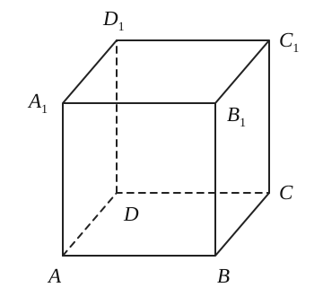

### 一、填空题

1. 已知圆锥的母线长为 $5\,\mathrm{cm}$，侧面积为 $20\pi\,\mathrm{cm}^2$，则此圆锥的体积为 \_\_\_\_\_\_\_\_\_\_\_\_\_\_\_\_$\mathrm{cm}^3$。
2. 如图，若正四棱柱的底面边长为 $2$，高为 $4$，则异面直线 $BD_1$ 与 $AD$ 所成角的大小是 \_\_\_\_\_\_\_\_\_\_\_\_\_\_\_\_。   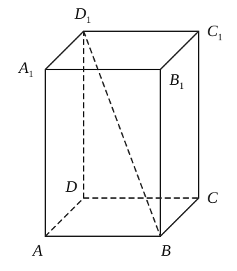
3. 直角三角形 $ABC$ 中，$\angle A=90^\circ$，$AB=3$，$AC=4$，以直角边 $AB$ 为轴将 $ABC$ 旋转一周，则所得旋转体的表面积为 \_\_\_\_\_\_\_\_\_\_\_\_\_\_\_\_；体积为 \_\_\_\_\_\_\_\_\_\_\_\_\_\_\_\_。
4. 过棱锥高的三等分点分别作平行于底面的截面，求它们把圆锥侧面分成三部分的面积之比 \_\_\_\_\_\_\_\_\_\_\_\_\_\_\_\_。
5. 设正四面体 $ABCD$ 的棱长为 $a$，$P$ 是棱 $AB$ 上的任意一点，且 $P$ 到面 $ACD$、$BCD$ 的距离分别为 $d_1$、$d_2$，则 $d_1+d_2 =$\_\_\_\_\_\_\_\_\_\_\_\_\_\_\_\_。
6. 如图：正方形 $ABCD$ 所在平面与正方形 $ABEF$ 所在平面成 $60^\circ$ 的二面角，则异面直线 $AD$ 与 $BF$ 所成角的余弦值是 \_\_\_\_\_\_\_\_\_\_\_\_\_\_\_\_。   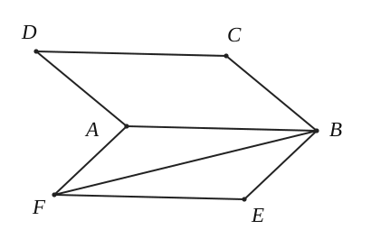
7. 正三棱锥 $P-ABC$ 高为 $2$，侧棱与底面所成角为 $45^\circ$，则点 $A$ 到侧面 $PBC$ 的距离为 \_\_\_\_\_\_\_\_\_\_\_\_\_\_\_\_。
8. 已知正三棱柱 $ABC-A'B'C'$ 的底面边长为 $2\,\mathrm{cm}$，高为 $5\,\mathrm{cm}$，则一质点自点 $A$ 出发，沿着三棱柱的侧面绕行两周到达点 $A_1$ 的最短路线的长为 \_\_\_\_\_\_\_\_\_\_\_\_\_\_\_\_$\mathrm{cm}$。   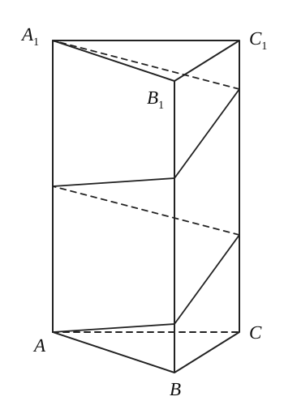

### 二、选择题

9. $l_1$、$l_2$、$l_3$ 是空间三条不同的直线，下列命题正确的是（　　）。

   A. $l_1\perp l_2,\ l_2\perp l_3\Rightarrow l_1\parallel l_3$                           B. $l_1\perp l_2,\ l_2\perp l_3\Rightarrow l_1\perp l_3$  
   C. $l_1\parallel l_2,\ l_2\parallel l_3\Rightarrow l_1\parallel l_3$                             D. $l_1\parallel l_2\parallel l_3\Rightarrow l_1,l_2,l_3$ 共面
   
10. 已知正方体的棱长为 $a$，沿图中对角面将它分割成两个部分，拼成如右图的平行六面体，则平行六面体的全面积为（　　）。

    A. $(8+2\sqrt{2})a^2$　　                                          B. $(2+4\sqrt{2})a^2$  
    C. $(4+2\sqrt{2})a^2$　　                                          D. $(6-4\sqrt{2})a^2$

    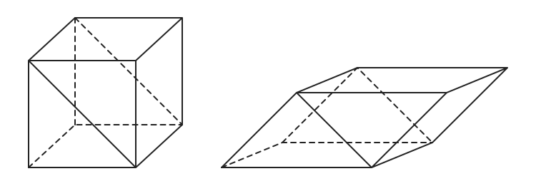

## 20261019 空间直线的方向向量和平面的法向量

### 解答题

1. 棱长为 $2$ 的正方体 $ABCD-A_1B_1C_1D_1$ 在如图所示的坐标系中，$E$、$F$ 分别为棱 $AB$ 和 $BC$ 的中点，$M$ 是棱 $BB_1$ 上一点，若 $D_1M\perp$ 平面 $EFB_1$，求点 $M$ 的的坐标。 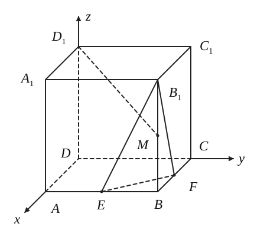

2. 如图，$\triangle ABC$ 中，$AC=BC=\dfrac{\sqrt{2}}{2}AB$，平面 $ABED\perp$ 平面 $ABC$，$ABED$ 是边长为 $1$ 的正方形，$G$、$F$ 分别是 $EC$、$BD$ 的中点。求证：$FG\perp$ 平面 $EBC$。（用空间向量）   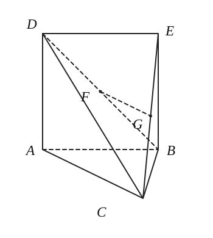

3. 如图，在长方体 $ABCD-A_1B_1C_1D_1$ 中，$AA_1=AD=1$，$E$ 为 $CD$ 的中点，$AB=2$。
   （1）用向量法求证：$B_1E\perp AD_1$；
   （2）在棱 $AA_1$ 上是否存在一点 $P$，使得 $DP\parallel$ 平面 $B_1AE$。若存在，求 $AP$ 的长；若不存在，说明理由。   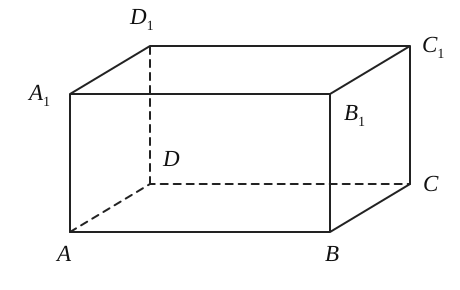

### 一、填空题

1. 半径为 $5$ 的球被一个平面所截，截面面积为 $16\pi$，则球心到截面的距离为 \_\_\_\_\_\_\_\_\_\_\_\_\_\_\_\_。

2. 正三棱锥的侧面都是直角三角形，底面边长为 $a$，它的全面积为 \_\_\_\_\_\_\_\_\_\_\_\_\_\_\_\_。

3. 若正四棱锥的底面边长为 $2\sqrt{3}\,\mathrm{cm}$，体积为 $4\,\mathrm{cm}^3$，则它的侧面与底面所成的二面角的大小是 \_\_\_\_\_\_\_\_\_\_\_\_\_\_\_\_。

4. 三棱锥的三个侧面两两垂直，其面积分别为 $S_1$、$S_2$、$S_3$，则该三棱锥的体积为 \_\_\_\_\_\_\_\_\_\_\_\_\_\_\_\_。

5. 若直线 $m$ 与平面 $\alpha$ 所成角为 $\dfrac{\pi}{3}$，直线 $a$ 在平面 $\alpha$ 上，且与 $m$ 异面，则直线 $m$ 与直线 $a$ 所成角的范围为 \_\_\_\_\_\_\_\_\_\_\_\_\_\_\_\_。

6. 如右图所示：一副三角板以平面 $ABC\perp$ 平面 $ACD$ 的方式放置，若 $AC=2\sqrt{2}$，则直线 $BD$ 和平面 $ABC$ 所成角的大小为 \_\_\_\_\_\_\_\_\_\_\_\_\_\_\_\_。   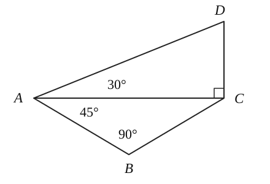

7. 当母线长为 $1$ 的圆锥的侧面积与底面积的差达到最大值时，其侧面展开图圆心角 $=\underline{\qquad\qquad}$。

8. ❌有下列五个命题：

   （1）若一个四棱柱有两个侧面垂直于底面，则该四棱柱为直四棱柱；

   （2）有一个面是多边形，其余各面是三角形的几何体是棱锥；

   （3）若四棱柱的四条对角线两两相等，则该四棱柱为直棱柱；

   （4）若一个平行六面体的==各个侧面==都是正方形，则这个平行六面体为正方体；

   （5）各条侧棱与底面所成的角都相等的棱锥是正棱锥。

   其中真命题的序号有 \_\_\_\_\_\_\_\_\_\_\_\_\_\_\_\_。【看错了】

### 二、选择题

9. 若异面直线 $a$、$b$ 分别在平面 $\alpha$、$\beta$ 内，$\alpha\cap\beta=c$，则直线 $c$（　　）。

   A. 与 $a$、$b$ 都相交　　                       B. 至少与 $a$、$b$ 中的一条相交\
   C. 与 $a$、$b$ 都不相交　　                    D. 至多与 $a$、$b$ 中的一条相交

10. 一个圆柱的侧面积展开图是一个正方形，这个圆柱的全面积与侧面积的比是（　　）。

    A. $\dfrac{1+2\pi}{2\pi}$　　 B. $\dfrac{1+4\pi}{4\pi}$　　 C. $\dfrac{1+2\pi}{\pi}$　　 D. $\dfrac{1+4\pi}{2\pi}$

## 20261020 空间向量在度量问题中的应用 1

### 解答题

1. 如图，直四棱柱 $ABCD-A_1B_1C_1D_1$ 中，$AA_1=2$，底面 $ABCD$ 是直角梯形，$\angle A$ 是直角，$AB$ 平行于 $CD$，$AB=4$，$AD=2$，$DC=1$，求直线 $B_1C$ 与平面 $ABC_1$ 所成角的大小。

   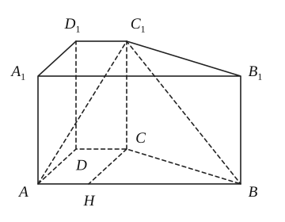

2. 已知正方体 $ABCD-A_1B_1C_1D_1$ 的棱长均为 $1$，$M$ 为棱 $A_1B_1$ 上的点，$N$ 为棱 $BB_1$ 的中点，异面直线 $AM$ 与 $CN$ 所成角的大小为 $\arccos\dfrac{2}{5}$，求 $\dfrac{|A_1M|}{|MB_1|}$ 的值。

   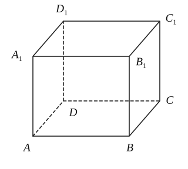

3. 已知矩形 $ABCD$ 内接于圆柱下底面的圆 $O$，$PA$ 是圆柱的母线，若 $AB=6$，$AD=8$，此圆柱的体积为 $300\pi$，求二面角 $B-PC-D$ 的大小。

   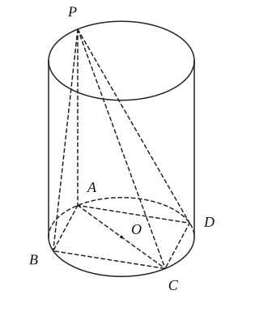

### 一、填空题

1. 正四棱锥的侧棱和底面边长都是 $a$，则它的全面积是 \_\_\_\_\_\_\_\_\_\_\_\_\_\_\_\_。

2. 把一个弧长为 $2\pi\,\mathrm{cm}$，半径为 $\sqrt{2}\,\mathrm{cm}$ 的扇形围成圆锥，则该圆锥的体积为 \_\_\_\_\_\_\_\_\_\_\_\_\_\_\_\_ $\mathrm{cm}^3$。

3. 已知 $ABCD-A_1B_1C_1D_1$ 是底面边长为 $1$ 的正四棱柱，高 $AA_1=2$，四面体 $AB_1D_1C$ 的体积 \_\_\_\_\_\_\_\_\_\_\_\_\_\_\_\_。

   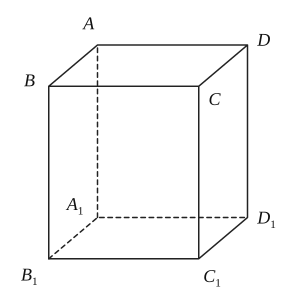

4. 已知直线 $m\perp$ 平面 $\alpha$，直线 $n$ 在平面 $\beta$ 内，给出下列命题：

   ① $\alpha\parallel\beta\Rightarrow m\perp n$；

   ② $\alpha\perp\beta\Rightarrow m\parallel n$；

   ③ $m\perp n\Rightarrow\alpha\parallel\beta$；

   ④ $m\parallel n\Rightarrow\alpha\perp\beta$。

   其中真命题的序号是 \_\_\_\_\_\_\_\_\_\_\_\_\_\_\_\_。

5. 在底面边长为 $2$ 的正三棱锥 $V-ABC$ 中，$E$ 是 $BC$ 的中点，若 $\triangle VAE$ 的面积是 $\dfrac{1}{4}$，则侧棱 $VA$ 与底面所成角的大小为 \_\_\_\_\_\_\_\_\_\_\_\_\_\_\_\_。

6. 在平行四边形 $ABCD$ 中，$AB=1$，$AC=\sqrt{3}$，$AD=2$；线段 $PA\perp$ 平面 $ABCD$，且 $PA=2$，则点 $D$ 到平面 $APB$ 的距离等于 \_\_\_\_\_\_\_\_\_\_\_\_\_\_\_\_。

7. 圆柱形容器内盛有高度为 $8\,\mathrm{cm}$ 的水，若放入三个相同的球（球的半径与圆柱的底面半径相同）后，水恰好淹没最上面的球，则球的半径是 \_\_\_\_\_\_\_\_\_\_\_\_\_\_\_\_ $\mathrm{cm}$。

   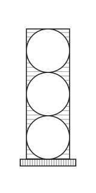

8. ❌在正方体的顶点中任意选择 $4$ 个顶点，对于由这 $4$ 个顶点构成的四面体的以下判断中，所有正确的结论是 \_\_\_\_\_\_\_\_\_\_\_\_\_\_\_\_（写出所有正确结论的编号）。

   ① 能构成每个面都是等边三角形的四面体；

   ② 能构成每个面都是直角三角形的四面体；

   ③ 能构成三个面为全等的等腰直角三角形，一个面为等边三角形的四面体；

   ④ 能构成三个面为不都全等的直角三角形，一个面为等边三角形的四面体。

   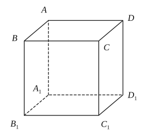

### 二、选择题

9. 三棱锥的“三侧棱与底面所成的角相等且底面是正三角形”是“三棱锥为正三棱锥”的（　　）条件。

   A. 充分不必要　　 B. 必要不充分　　 C. 充要　　 D. 既不充分又不必要

10. 一个球与一个正三棱柱的三个侧面和两个底面都相切，已知这个球的体积是 $\dfrac{32}{3}\pi$，那么该三棱柱的体积是（　　）。

    A. $96\sqrt{3}$　　 B. $16\sqrt{3}$　　 C. $24\sqrt{3}$　　 D. $48\sqrt{3}$

## 20261021 空间向量在度量问题中的应用 2

### 练习

1. 已知三棱锥 $A-BCD$ 的三条侧棱 $AB$、$AC$、$AD$ 两两垂直，且 $AB=1$，$AC=2$，$AD=3$，求顶点 $A$ 到平面 $BCD$ 的距离。

2. 如图所示，在棱长为 $2$ 的正方体 $ABCD-A_1B_1C_1D_1$ 中，$E$、$F$ 分别为线段 $DD_1$、$BD$ 的中点。
   （1）求直线 $EF$ 与平面 $B_1CD_1$ 所成的角的大小。（2）求 $F$ 到平面 $B_1CD_1$ 的距离。
      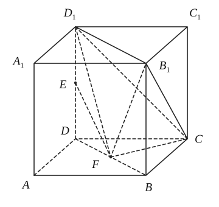

3. 直四棱柱 $ABCD-A_1B_1C_1D_1$ 中，已知 $AB\parallel CD$，$AB=AD=1$，$D_1D=CD=2$，$AB\perp AD$。
   （1）求 $D_1B$ 与平面 $D_1DCC_1$ 所成角的大小；
   （2）在 $BB_1$ 上是否存在一点 $F$，使 $F$ 到平面 $D_1BC$ 的距离为 $\dfrac{\sqrt{3}}{3}$，若存在，则指出该点的位置；若不存在，请说明理由。
   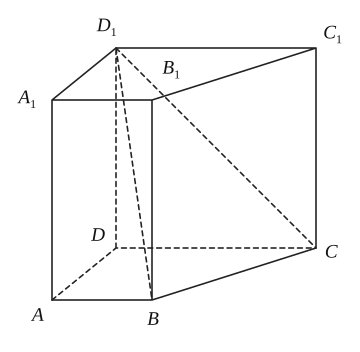

4. 如图，在三棱锥 $P-ABC$ 中，$PA\perp$ 平面 $ABC$，$AB\perp AC$，$|PA|=|AC|=\dfrac{1}{2}|AB|$，$M$、$S$ 分别为 $PB$、$BC$ 的中点，$N$ 为 $AB$ 上一点，$|BN|=3|NA|$。
   （1）求证：$CM\perp SN$；
   （2）求二面角 $P-BC-A$ 的大小。
   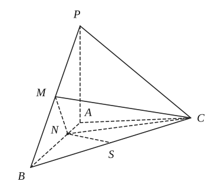

5. 如图，正三棱柱 $ABC-A_1B_1C_1$ 中，$AA_1=4$，$AC=BC=2$。
   （1）求点 $B$ 到平面 $AB_1C$ 的距离。
   （2）求直线 $B_1B$ 与平面 $AB_1C$ 所成角的正切值。
   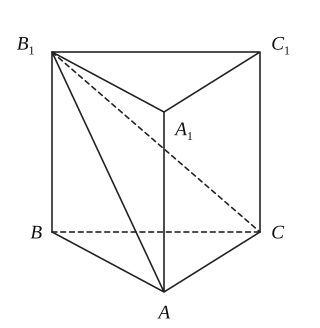

### 一、填空题

1. 在正方体的 $12$ 条棱所在的直线中共有异面直线 \_\_\_\_\_\_\_\_\_\_\_\_\_\_\_\_ 对。
2. 若圆柱的侧面展开图是一个正方形，则它的母线长和底面半径的比值是 \_\_\_\_\_\_\_\_\_\_\_\_\_\_\_\_。
3. 若一个圆锥的轴截面是边长为 $4\,\mathrm{cm}$ 的等边三角形，则这个圆锥的侧面积为 \_\_\_\_\_\_\_\_\_\_\_\_\_\_\_\_ $\mathrm{cm}^2$。
4. 异面直线 $a$、$b$ 所成的角为 $60^\circ$，过空间一定点 $P$，作直线 $L$，使 $L$ 与 $a$、$b$ 所成的角均为 $60^\circ$，这样的直线 $L$ 有 \_\_\_\_\_\_\_\_\_\_\_\_\_\_\_\_ 条。
5. 已知 $ABCD-A_1B_1C_1D_1$ 是底面边长为 $1$ 的正四棱柱，高 $AA_1=2$，则直线 $BD_1$ 与面 $CDD_1C_1$ 所成角的大小是 \_\_\_\_\_\_\_\_\_\_\_\_\_\_\_\_。   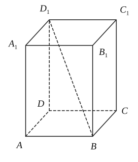
6. 正六棱锥的侧面积等于 $36\sqrt{13}$，底面边长为 $6$，则此棱锥的体积为 \_\_\_\_\_\_\_\_\_\_\_\_\_\_\_\_。
7. 如图，半圆直径 $AB$ 为 $6$，点 $C$ 为半圆弧上任意一点，图中阴影部分绕直线 $AB$ 旋转一周所得旋转体的体积的最小值是 \_\_\_\_\_\_\_\_\_\_\_\_\_\_\_\_。   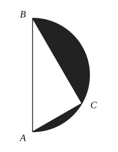
8. 三棱锥 $S-ABC$ 中，$E$、$F$、$G$、$H$ 分别为 $SA$、$AC$、$BC$、$SB$ 的中点，则截面 $EFGH$ 将三棱锥 $S-ABC$ 分成两部分的体积之比为 \_\_\_\_\_\_\_\_\_\_\_\_\_\_\_\_。   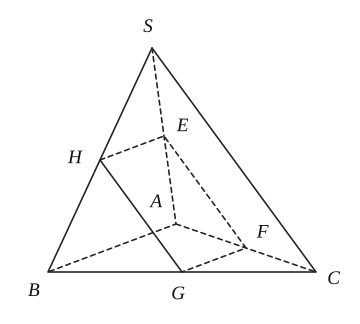

### 二、选择题

9. 在下列条件中，可判断平面 $\alpha$ 与 $\beta$ 平行的是（　　）。
   A. $\alpha$、$\beta$ 都垂直于平面 $r$。
   B. $\alpha$ 内存在不共线的三点到 $\beta$ 的距离相等。
   C. $l$、$m$ 是 $\alpha$ 内两条直线，且 $l\parallel\beta$，$m\parallel\beta$。
   D. $l$、$m$ 是两条异面直线，且 $l\parallel\alpha$，$m\parallel\alpha$，$l\parallel\beta$，$m\parallel\beta$。

10. 将若干水倒入底面半径为 $2\,\mathrm{cm}$ 的圆柱器皿中（底面水平放置），量得水面的高度为 $6\,\mathrm{cm}$。若将这些水倒入轴截面是正三角形的倒置的圆锥形器皿中，则水面的高度是（　　）。
    A. $6\sqrt{3}\,\mathrm{cm}$　　 B. $6\,\mathrm{cm}$　　 C. $2\sqrt[3]{18}\,\mathrm{cm}$　　 D. $3\sqrt[3]{12}\,\mathrm{cm}$
